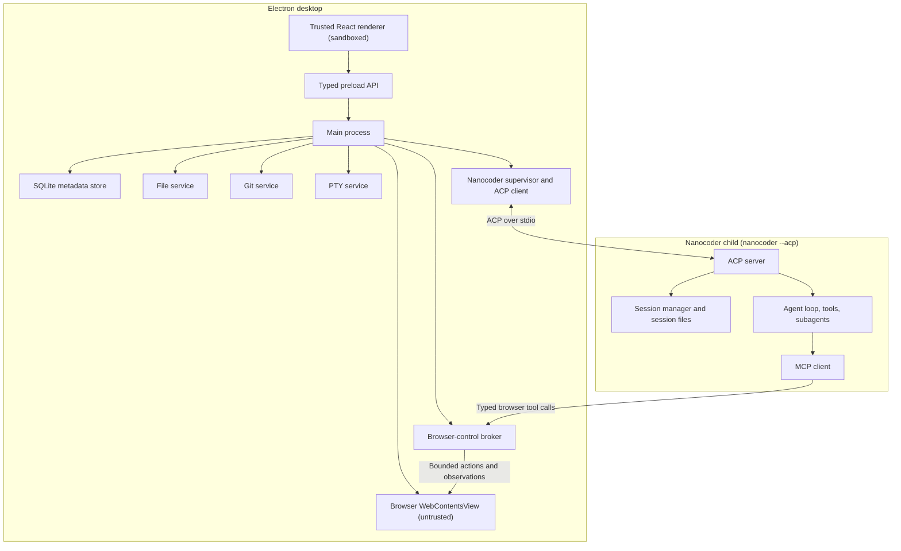
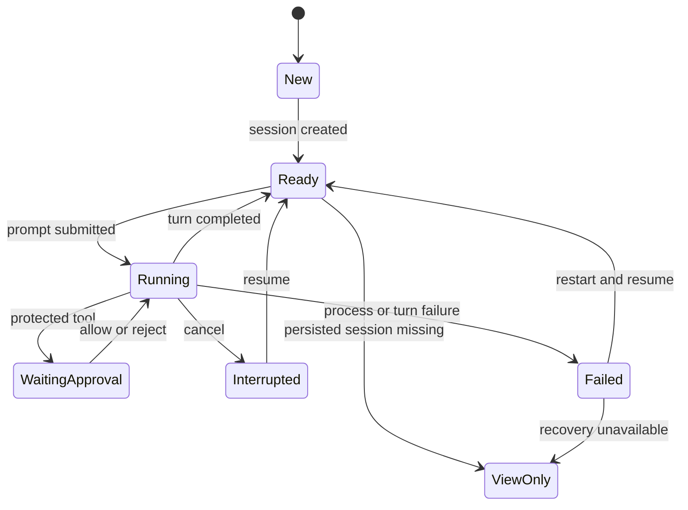
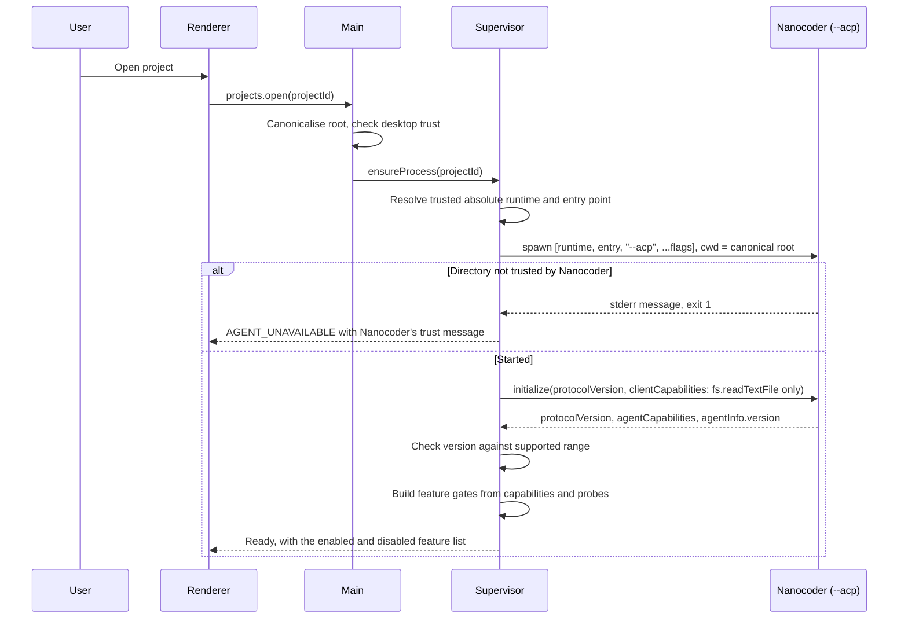
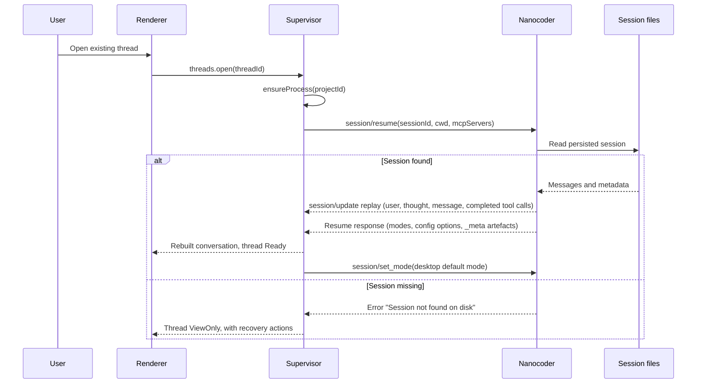
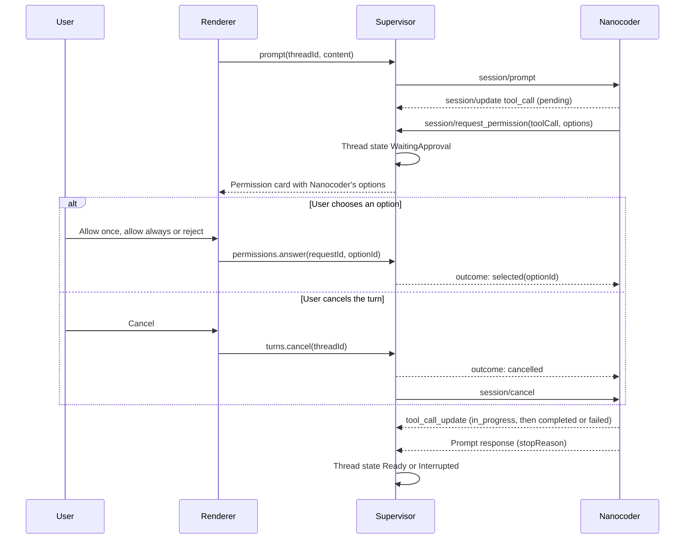
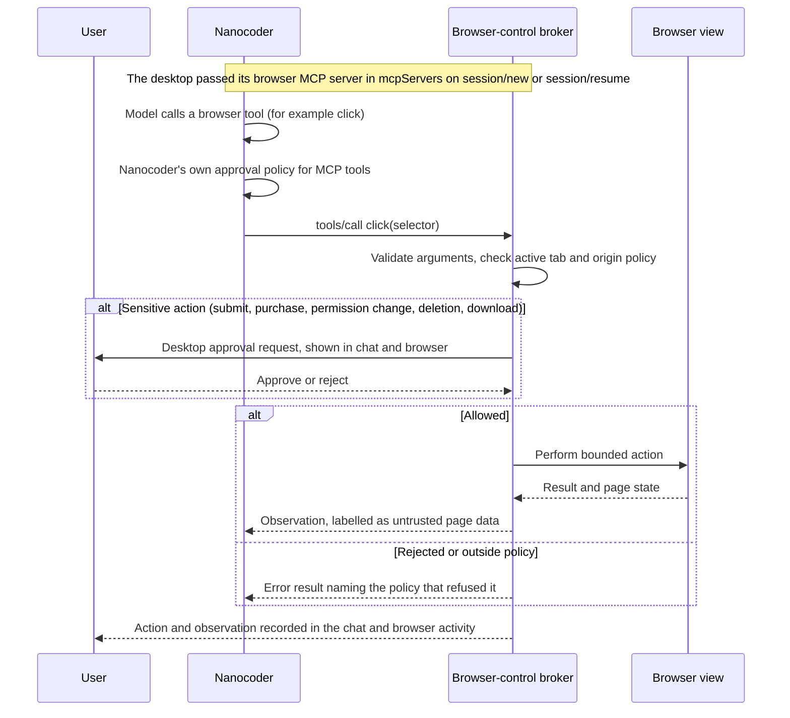
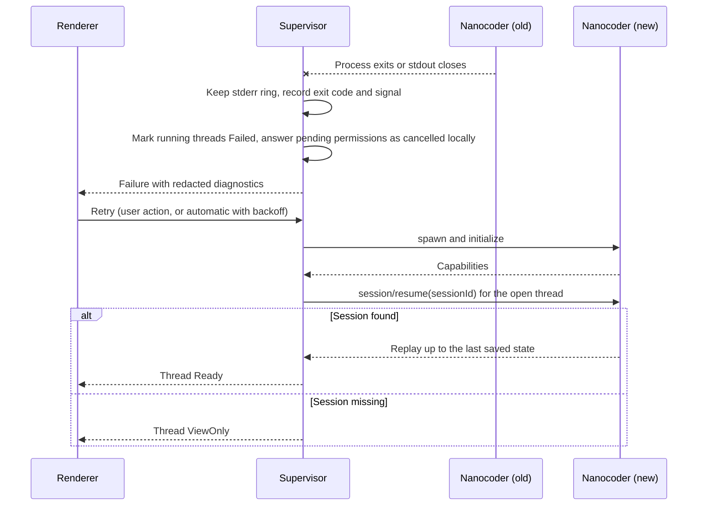

# Architecture

The processes, trust boundaries, IPC contract, process policy, thread state machine and key sequences of Nanocoder Desktop.

- Status: Draft
- Last updated: 2026-10-27
- Drafted by: @akramcodez

## Scope

This file describes behaviour and structure. It builds on the [whitepaper's architecture][wp-arch] (Decided) and adds the detail a builder needs. Anything this file adds beyond the whitepaper is marked with its status. Visual design: see [`DESIGN.md`](../DESIGN.md).

## Process model



| Component | Runs in | Trust | Responsibility |
|---|---|---|---|
| Main process | Electron main | Privileged | Owns windows, IPC handlers, every service below, and the database. The only place that touches the filesystem, Git, processes or the network on the desktop's behalf. |
| Trusted renderer | Sandboxed renderer process | Trusted code, untrusted input | Renders state and sends user intents. Has no Node, no filesystem access and no direct IPC beyond the preload API (`SEC-01`, `SEC-15`). |
| Typed preload | Preload script with context isolation | Bridge | Exposes one narrow, typed API object through `contextBridge`. Never exposes `ipcRenderer` itself (`SEC-02`). |
| File service | Main | Privileged | Canonicalises paths, lists directories lazily, reads previews within limits, watches for changes, answers ACP `fs/read_text_file` (`FILE-`, `SEC-03`, `SEC-04`, `ACP-11`). |
| Git service | Main | Privileged | Runs the system `git` with argument arrays, parses NUL-delimited output, produces status and diffs (`GIT-`, `SEC-06`). |
| PTY service | Main, or a utility process (Suggestion (not discussed)) | Privileged | Hosts the single project terminal (`TERM-`). A native PTY module that crashes should not take the main process down, which is why a utility process is worth measuring. |
| Browser view | `WebContentsView` in its own renderer | Untrusted | Renders local previews and, when enabled, public pages. No Node, no preload, no desktop IPC, its own persistent partition (`BRW-01`, `SEC-12`). |
| Browser-control broker | Main | Privileged | Turns typed agent tool calls into bounded actions on the active browser view, enforces origin policy, asks the user for sensitive actions, labels observations as page data (`BRW-11` to `BRW-16`, `SEC-13`). |
| Nanocoder supervisor and ACP client | Main | Privileged | Resolves and launches the trusted Nanocoder runtime, owns the ACP connection, keeps the stderr ring, restarts on failure, routes session updates and permission requests to threads (`ACP-`). |
| SQLite store | Main | Privileged | Desktop metadata only (`DATA-`). |

### Why one ACP process per project

The whitepaper sets one supervised ACP process per project (Decided, [Process policy][wp-process]). Nanocoder's own behaviour confirms the choice: project configuration, MCP servers, custom tools and skills are read once, from the directory the agent process starts in ([Nanocoder ACP docs][nc-acp-req]). A process started in one project cannot serve another project's configuration, so the supervisor always starts Nanocoder with its working directory set to the canonical project root.

Each session still runs its tools in its own `cwd` ([nanocoder#1731][nc1731]), so threads started in a subdirectory of the project work inside one process.

## IPC contract principles

The renderer is trusted code that still handles untrusted input (repository file names, model output, page titles). The IPC surface is designed so that a compromised renderer gains as little as possible.

Decided principles (whitepaper: "sandbox renderers and validate every narrow IPC method", [Threat model][wp-threat]):

1. **Narrow.** One method per user intent, scoped by IDs the main process owns. `files.preview(projectId, relativePath)`, never `fs.readFile(absolutePath)`. The renderer never sends an absolute path, except one returned by a main-process folder picker.
2. **Typed.** Request, response and event types live in one shared module that both sides import.
3. **Validated.** Every request is checked against a runtime schema in the main process before any work starts. Unknown fields are rejected, strings and arrays are length-bounded.
4. **Sender-checked.** Every handler checks that the message came from the app's own frame, following Electron's guidance to validate the sender of all IPC messages ([Electron security][el-security], item 17).
5. **No capability handles.** The renderer receives data (file text, diff hunks, status rows), never a handle that grants further access.

The following detail is Suggestion (not discussed):

- **One result shape.** Every request resolves to `{ok: true, value}` or `{ok: false, error}`, never a thrown exception across the bridge.
- **Error codes.** `error` carries a stable `code`, a user-safe `message` and a `retryable` flag:

  | Code | Meaning |
  |---|---|
  | `VALIDATION` | The request failed schema validation. Always a bug in the renderer. |
  | `NOT_FOUND` | The project, thread or path does not exist. |
  | `OUTSIDE_ROOT` | The resolved path left the canonical project root. |
  | `LIMIT` | A size, entry or time limit was hit. The message says which. |
  | `UNSUPPORTED` | The connected Nanocoder does not offer the capability. |
  | `AGENT_UNAVAILABLE` | The Nanocoder process is not running or not ready. |
  | `BUSY` | Another root turn is running in this project's process (`CHAT-17`). |
  | `DENIED` | The user or policy refused the action. |
  | `INTERNAL` | Anything else. Details go to the diagnostics ring, never to the message. |

- **Safe messages.** Error messages contain project-relative paths only, never secrets, environment values or stderr.
- **Ordered streams.** Events pushed from main carry a per-thread sequence number. A renderer that sees a gap asks for a fresh snapshot instead of guessing.
- **Bounded event rate.** High-rate ACP chunks are batched before they cross IPC, so a fast model cannot flood the renderer.
- **Cancellable work.** Long requests (large diffs, deep listings) accept a cancellation ID.

## ACP over stdio

Decided ([whitepaper, Architecture][wp-arch]): standard output is protocol only, and standard error is kept in a bounded, redacted, in-memory diagnostic ring.

| Concern | Behaviour | Status |
|---|---|---|
| Launch | Trusted absolute runtime, argument array, no shell, working directory set to the canonical project root (`ACP-01`, `SEC-05`). | Decided |
| Framing | Newline-delimited JSON-RPC through the ACP SDK's NDJSON stream. Nanocoder writes the protocol to stdout and startup failures to stderr ([source][nc-server]). | Decided |
| Protocol violations | A line on stdout that is not a valid frame ends the connection and marks the process failed, with the raw line kept only in the stderr ring (`ACP-15`). | Suggestion (not discussed) |
| stderr ring | In memory only, bounded by size (256 KiB is a starting point), redacted before storage, never written to disk, shown in a diagnostics view, exported only after the user reviews it (`ACP-16`, `SEC-08`). | Decided (ring); the size is a Suggestion (not discussed) |
| Shutdown | Close stdin first. Nanocoder shuts down gracefully when the connection closes ([source][nc-shutdown]). After a grace period, end the process tree. | Suggestion (not discussed) |

## Process policy

| Rule | Detail | Status |
|---|---|---|
| One ACP process per project | Started on first use of a project, working directory at the canonical root. | Decided ([Process policy][wp-process]) |
| One root turn at a time | The desktop refuses a new prompt in any thread of a project while another thread in the same process is mid-turn (`CHAT-17`). Nanocoder will not do this for you: it queues prompts within a session ([source][nc-queue]) but runs different sessions concurrently, while model state ([source][nc-model]) and the subagent approval handler ([docs][nc-acp-limits]) are shared by the whole process. | Decided |
| Bounded subagents | Nanocoder enforces a delegation depth of 2 and at most 5 concurrent subagents ([source][nc-subagent-limits]). The desktop shows their parent-child status and cancellation where Nanocoder exposes it (`SUB-`). | Decided (bounds are Nanocoder's) |
| Idle shutdown | After a period with no running turn and no open thread for the project, close open sessions (`session/close`) and stop the process. Resume on next use (`ACP-23`). | Decided in principle ("resumes persisted sessions after idle shutdown"); the period is a Suggestion (not discussed) |
| One active project | v1 shows one active project at a time ([Main window][wp-window]). What happens to a background project's running turn is `OQ-19`. | Decided (one active); background behaviour Open |
| Parallel root turns | Future work, after Nanocoder isolates model state per session. | Decided (deferred) |

## Sources of truth

From the [whitepaper, Sources of truth][wp-truth] (Decided), with the reading rules this plan adds.

| Data | Source of truth | Desktop rule |
|---|---|---|
| Model conversation and continuation | Nanocoder session file | Rendered from ACP replay. Never copied into SQLite (`DATA-04`). |
| Current file contents | Filesystem | Read on demand through the file service. Never cached to disk. |
| Change status and review | Git repository and index | Recomputed from `git`. Agent events only label which files a turn touched. |
| Navigation, recent and archive state, touched-file summaries, subagent-run projections, UI state | Desktop SQLite | Owned by the desktop. Losing it loses navigation, not history (`DATA-08`). |
| Browser cookies, storage, cache, history | Browser partition | Owned by Electron's session storage for that partition. Cleared from settings (`BRW-08`). |
| Directory trust | Nanocoder's trust store for Nanocoder; the desktop's `trusted` flag for Git and watchers | One prompt sets both (`DEC-30`, [Directory trust](acp-integration.md#directory-trust)). |

## Thread state machine

The states are Decided ([whitepaper, Thread states][wp-states]). The behaviour table is how this plan reads them.



| State | Entered when | The user can | Leaves when |
|---|---|---|---|
| New | The user starts a thread. No Nanocoder session exists yet. | Type a first prompt. | `session/new` returns a session ID, which is stored before anything else (`CHAT-04`). |
| Ready | A session exists and no turn is running. Also the state after replay on resume. | Send a prompt (unless another thread in the project is running, `CHAT-17`), change mode or model, rename, archive. | A prompt is submitted, or a resume finds the session missing. |
| Running | `session/prompt` is in flight. | Watch the stream, cancel. | The prompt resolves (`end_turn` and similar: Ready; `cancelled`: Interrupted), rejects (Failed), or a permission request arrives (WaitingApproval). |
| WaitingApproval | Nanocoder sent `session/request_permission`, or the browser broker needs a sensitive-action decision. | Choose one of the offered options, or cancel the turn. | The user answers. A cancel while waiting answers the request as cancelled and moves to Interrupted. |
| Interrupted | The user cancelled and Nanocoder returned `stopReason: cancelled`. | Send the next prompt. | The next prompt is submitted (the whitepaper's "resume"). |
| Failed | The process exited, the connection broke, or the prompt request rejected. | See the error, open diagnostics, retry. | The supervisor restarts Nanocoder and `session/resume` succeeds (Ready), or the session is gone (ViewOnly). |
| ViewOnly | `session/resume` reports the session is not on disk, for example after Nanocoder's retention deleted it (`ACP-19`). | Read the desktop metadata (title, last activity, touched files), start a new thread in the same project, remove the thread. | Never, for this thread. |

Rules:

- **Archive is separate.** Archived is UI metadata on any state, not a lifecycle state (`CHAT-13`).
- **Replay has a loading phase.** While `session/resume` replays history, the thread is Ready but its composer is disabled until the response arrives. Suggestion (not discussed): name this "Ready (replaying)" in the UI state rather than adding a lifecycle state.
- **Run state is recorded.** The last known run state is stored in `THREAD.run_state` so a crash is visible on the next launch: a thread recorded as Running when the app starts is shown as Failed until it is resumed (`DATA-02`).

## Sequences

### Startup and capability negotiation



Details: [`acp-integration.md`](acp-integration.md#capability-negotiation-at-startup).

### Resume



The desktop uses `session/resume`, not `session/load`, for this path. At the inspected commit, `session/load` with an unknown ID creates an empty in-memory session instead of failing ([source][nc-load]), which would hide a missing session.

### Permission request



Subagent tool approvals arrive the same way, with tool call IDs prefixed `subagent:` ([source][nc-subagent-approval]). See [`subagents.md`](features/subagents.md).

### Browser tool call

This sequence depends on Nanocoder honouring client `mcpServers` ([#116][i116], Proposed) and on the adapter transport (`OQ-17`).



### Crash recovery



Nanocoder saves the session in a `finally` block after each prompt ([source][nc-save]), so a crash mid-turn loses that turn's unsaved output. The replay shows the last saved state, not the partial stream the user saw. Automatic restart is limited (Suggestion (not discussed): at most three attempts with increasing delay, then wait for the user) so a crash loop cannot spin.

## Proposed source tree

Proposal, not a decision. It follows the NC convention of `@/*` mapped to `source/*` with `tsc-alias` ([Stack suggestions][stack]) and keeps `.spec.ts` files beside their source. The final shape depends on the bundler choice (`OQ-23`).

```text
source/
  main/
    index.ts                  App lifecycle and window creation
    ipc/                      One handler module per domain, schema validation, sender checks
    projects/                 Project registry, canonical roots, trust
    nanocoder/
      runtime.ts              Resolve the trusted runtime and entry point
      supervisor.ts           Spawn, restart, idle shutdown
      acp-client.ts           ClientSideConnection, session routing
      capabilities.ts         Feature gates from initialize and probes
      stderr-ring.ts          Bounded, redacted ring
    files/                    Canonicalisation, listing, preview, watching, ACP reads
    git/                      Invocation, NUL status parser, diff parser
    pty/                      PTY host
    browser/                  WebContentsView, partition, permission and download handlers
    browser-control/          Broker, origin policy, MCP server
    store/                    SQLite connection, migrations, repositories
  preload/
    index.ts                  contextBridge API
  renderer/
    main.tsx
    app/                      Routing and state
    features/
      chats/
      subagents/
      files/
      review/
      terminal/
      browser/
      settings/
  shared/
    ipc/                      Channel names, request and response types, error codes
    acp/                      Renderer-facing projections of ACP updates
```

[wp-arch]: https://github.com/Nano-Collective/docs/blob/3ec3b1c6a21277556a9df3000f4e0f244e35e3bb/content/collective/whitepapers/nanocoder-desktop.md?plain=1#L189-L246
[wp-process]: https://github.com/Nano-Collective/docs/blob/3ec3b1c6a21277556a9df3000f4e0f244e35e3bb/content/collective/whitepapers/nanocoder-desktop.md?plain=1#L277-L284
[wp-window]: https://github.com/Nano-Collective/docs/blob/3ec3b1c6a21277556a9df3000f4e0f244e35e3bb/content/collective/whitepapers/nanocoder-desktop.md?plain=1#L147-L166
[wp-truth]: https://github.com/Nano-Collective/docs/blob/3ec3b1c6a21277556a9df3000f4e0f244e35e3bb/content/collective/whitepapers/nanocoder-desktop.md?plain=1#L344-L355
[wp-states]: https://github.com/Nano-Collective/docs/blob/3ec3b1c6a21277556a9df3000f4e0f244e35e3bb/content/collective/whitepapers/nanocoder-desktop.md?plain=1#L168-L187
[wp-threat]: https://github.com/Nano-Collective/docs/blob/3ec3b1c6a21277556a9df3000f4e0f244e35e3bb/content/collective/whitepapers/nanocoder-desktop.md?plain=1#L585-L633
[stack]: https://docs.nanocollective.org/collective/projects/stack-suggestions
[el-security]: https://www.electronjs.org/docs/latest/tutorial/security
[i116]: https://github.com/Nano-Collective/docs/issues/116
[nc1731]: https://github.com/Nano-Collective/nanocoder/pull/1731
[nc-acp-req]: https://github.com/Nano-Collective/nanocoder/blob/8a5f4d46317d93128c531f39b80b5ac6fd2da25b/docs/features/acp.md?plain=1#L77-L82
[nc-acp-limits]: https://github.com/Nano-Collective/nanocoder/blob/8a5f4d46317d93128c531f39b80b5ac6fd2da25b/docs/features/acp.md?plain=1#L84-L88
[nc-server]: https://github.com/Nano-Collective/nanocoder/blob/8a5f4d46317d93128c531f39b80b5ac6fd2da25b/source/acp/acp-server.ts#L24-L83
[nc-shutdown]: https://github.com/Nano-Collective/nanocoder/blob/8a5f4d46317d93128c531f39b80b5ac6fd2da25b/source/acp/acp-server.ts#L85-L102
[nc-queue]: https://github.com/Nano-Collective/nanocoder/blob/8a5f4d46317d93128c531f39b80b5ac6fd2da25b/source/acp/acp-agent.ts#L204-L215
[nc-model]: https://github.com/Nano-Collective/nanocoder/blob/8a5f4d46317d93128c531f39b80b5ac6fd2da25b/source/acp/acp-agent.ts#L611-L616
[nc-load]: https://github.com/Nano-Collective/nanocoder/blob/8a5f4d46317d93128c531f39b80b5ac6fd2da25b/source/acp/acp-agent.ts#L167-L196
[nc-save]: https://github.com/Nano-Collective/nanocoder/blob/8a5f4d46317d93128c531f39b80b5ac6fd2da25b/source/acp/acp-agent.ts#L473-L502
[nc-subagent-limits]: https://github.com/Nano-Collective/nanocoder/blob/8a5f4d46317d93128c531f39b80b5ac6fd2da25b/source/subagents/subagent-executor.ts#L70-L74
[nc-subagent-approval]: https://github.com/Nano-Collective/nanocoder/blob/8a5f4d46317d93128c531f39b80b5ac6fd2da25b/source/acp/acp-conversation.ts#L90-L160
