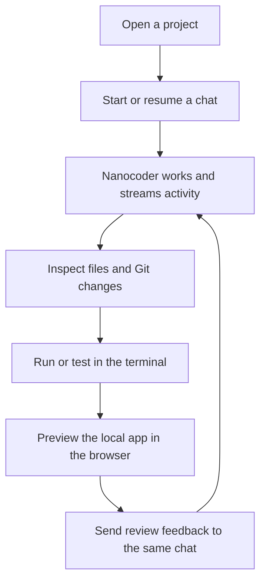

# Overview

What Nanocoder Desktop is, who it is for, what v1 includes and excludes, and what would prove it works.

- Status: Draft
- Last updated: 2026-10-23
- Drafted by: @akramcodez

## What it is

Nanocoder Desktop is a **desktop agent workspace**, not an IDE. The user hands a task to Nanocoder, follows the work as it streams, reviews the real result in the repository, runs it, previews it, and sends feedback back into the same chat. It is a separate Electron application that starts `nanocoder --acp` as a child process and drives it over the Agent Client Protocol (ACP) ([whitepaper, Product boundary][wp-boundary]).

It adds no second agent. Nanocoder keeps ownership of models, prompts, tools, approvals, skills, MCP, LSP, memory and canonical conversation history ([whitepaper, introduction][wp-intro]). The desktop owns the workspace around the agent: projects, thread navigation, files, Git review, a terminal and an isolated browser.

In @puri-adityakumar's framing on [#118][i118], Scriptura is an IDE (you write code with AI help) and Nanocoder Desktop is an agent development environment, or ADE (you hand off a task and review the result). That framing is Proposed (awaiting @will-lamerton).

## The problem

Nanocoder's terminal interface works well for an active coding turn. It does not give the user one persistent place to return to project chats, inspect the repository, review its actual Git state, run the result and preview a local application. Editor integrations cover part of that, but they tie the user to a particular editor ([whitepaper, Problem][wp-problem]).

The gap is not another agent. It is a small workspace around the agent Nanocoder already ships.

## Intended audience

From the [whitepaper][wp-audience]:

- Developers who already use, or want to use, Nanocoder, including CLI-oriented developers who want a project-oriented loop for longer tasks and review.
- Designers, product builders and other technical users who find a CLI overwhelming but still want to work with real repositories, local development servers and agent-assisted coding.
- Anyone who wants to keep their current editor and model provider.

Not the audience: users looking for a full IDE, cloud-only execution, unrestricted OS-level computer use, or a general desktop assistant. On [#118][i118], @jason1015-coder suggested widening the product into a general chat app; @puri-adityakumar replied that it should stay focused on coding. That reply is Proposed (awaiting @will-lamerton), and this plan assumes the coding focus.

## Principles

Every Nano Collective project is **privacy-respecting**, **local-first** and **open for all** ([Brand Guidelines][brand]). For this project they mean:

- **Privacy-respecting.** Provider credentials stay in Nanocoder's existing stores. The desktop adds no account and no cloud control plane, and it never stores transcripts, file contents, tool results or stderr ([`data-model.md`](data-model.md)).
- **Local-first.** Projects, Git state, terminals, browser sessions and agent execution stay on the user's machine.
- **Open for all.** MIT licensed, provider-neutral, and usable without a proprietary editor.

The whitepaper adds four project-specific principles ([whitepaper, Principles][wp-principles]):

- **One agent source of truth.** Nanocoder owns prompts, providers, tools, approvals, sessions, skills, MCP, LSP and memory.
- **Review reality, not claims.** The filesystem and Git are authoritative for files and diffs. Agent events are attribution hints.
- **Least privilege at every boundary.** The renderer, ACP client callbacks, project services, terminal and browser view each get only the access they need.
- **Small product scope, explicit future.** A focused v1 is better than a partial IDE or an unreliable multi-agent system.

## The product loop

Source: [whitepaper, Product boundary][wp-boundary].

## v1 scope

### User experience

| # | A user can | Feature file | Success items |
|---|---|---|---|
| 1 | Add a project and start or resume its durable Nanocoder chats. | [`chats-and-sessions.md`](features/chats-and-sessions.md) | `SP-02`, `SP-03`, `SP-06` |
| 2 | Follow streamed reasoning, messages, tools, diffs and approvals. | [`chats-and-sessions.md`](features/chats-and-sessions.md) | `SP-03`, `SP-04` |
| 3 | Delegate bounded subtasks and follow each child agent. | [`subagents.md`](features/subagents.md) | `SP-05` |
| 4 | Browse files, review the real Git worktree, and send observations to chat. | [`file-browser.md`](features/file-browser.md), [`git-review.md`](features/git-review.md) | `SP-07`, `SP-08`, `SP-09` |
| 5 | Run the project in an integrated terminal. | [`terminal.md`](features/terminal.md) | `SP-10` |
| 6 | Let Nanocoder inspect and act inside an isolated browser, with approval for sensitive operations. | [`browser.md`](features/browser.md) | `SP-11` |
| 7 | Relaunch the application and continue the same thread. | [`chats-and-sessions.md`](features/chats-and-sessions.md) | `SP-06` |

Status: Decided ([whitepaper, v1 scope][wp-scope]).

### Engineering requirements

| Requirement (from the whitepaper) | Where this plan meets it |
|---|---|
| Reuse Nanocoder instead of forking its behaviour. | [`architecture.md`](architecture.md), [`acp-integration.md`](acp-integration.md) |
| Keep provider credentials and configuration under Nanocoder's ownership. | `SEC-07`, `CHAT-10` |
| Use a versioned, capability-negotiated process boundary. | `ACP-02` to `ACP-04` |
| Treat the filesystem and Git as authoritative for workspace state. | `FILE-09`, `GIT-02`, `GIT-06` |
| Keep remote browser content isolated from desktop privileges, and expose browser control only through a narrow, auditable tool boundary. | `BRW-01`, `BRW-11`, `SEC-12`, `SEC-13` |
| Make process failure and unsupported capabilities visible. | `ACP-03`, `ACP-17`, `CHAT-15` |
| Remain viable on macOS, Windows and Linux. | [`testing-strategy.md`](testing-strategy.md), [`release-and-distribution.md`](release-and-distribution.md) |

Status: Decided ([whitepaper, Engineering requirements][wp-scope]).

The whitepaper also sets an information architecture for the main window. Visual design: see `DESIGN.md` (not yet written). The behavioural part that matters here is that v1 has one active project, chat, preview and terminal at a time ([whitepaper, Main window][wp-window]).

## Non-goals for v1

Decided, from the [whitepaper, What it is not][wp-not]:

- unrestricted OS-level computer use, arbitrary Chrome DevTools Protocol (CDP) access, or browser control outside the dedicated app browser;
- cloud execution or cross-device sync;
- unbounded cross-project agent orchestration or autonomous scheduling;
- Git worktree creation and handoff;
- automations and scheduled tasks;
- a skills or plugin marketplace;
- GitHub pull request review integration;
- a full code editor, debugger, language-server UI or source control client;
- rich PDF, spreadsheet, presentation, image or audio editing;
- universal memory across unrelated chats.

Also out of v1:

- **Parallel root turns.** One user-initiated root turn runs at a time per project process, because model state is process-global in Nanocoder ([whitepaper, Process policy][wp-process]). Decided.
- **Destructive Git actions.** Staging, discarding, committing and branch actions come after read-only review ships ([whitepaper, Git diff and review][wp-git]). Decided.
- **A general chat app.** Proposed (awaiting @will-lamerton), [#118][i118].
- **Scriptura plugin compatibility.** Asked by @jason1015-coder on [#118][i118-plugin], unanswered. Open, tracked as `OQ-12` in [`open-questions.md`](open-questions.md).

These are exclusions, not dead ends. The first release should prove the project, chat and review loop before adding orchestration.

## v1 success picture

The first release succeeds when a user can do each of the following ([whitepaper, v1 success picture][wp-success]). The notes column records what this plan found that the whitepaper does not yet say.

| ID | A user can | Main requirements | Notes |
|---|---|---|---|
| SP-01 | Install and launch the app on each supported operating system. | `REL-05`, `REL-07` | Signing and notarisation have no owner ([#120][i120], Open). Without them, macOS Gatekeeper blocks the app by default. |
| SP-02 | Open a real repository. | `CHAT-01`, `CHAT-02`, `FILE-01` | Nanocoder refuses to start ACP in an untrusted directory ([nanocoder#1847][nc1847]). How desktop trust maps to Nanocoder trust is `OQ-14`. |
| SP-03 | Start a Nanocoder chat and see structured streaming and tool activity. | `CHAT-04`, `CHAT-05`, `ACP-05` | |
| SP-04 | Approve or reject a protected operation. | `CHAT-06`, `CHAT-11`, `ACP-10`, `ACP-13` | ACP sessions start in `auto-accept`, where file edits apply without a prompt ([source][nc-mode]). The desktop must choose the starting mode (`OQ-15`). |
| SP-05 | Delegate a bounded subtask, observe the child run, and stop it when needed. | `SUB-01` to `SUB-04` | At the inspected commit, ACP exposes no child IDs and no per-child cancel. Stopping means cancelling the whole turn unless Nanocoder changes ([`subagents.md`](features/subagents.md)). |
| SP-06 | Close and relaunch everything, then continue the same chat with its model context intact. | `CHAT-08`, `ACP-06`, `ACP-19` | Nanocoder deletes sessions idle for 30 days or beyond 100 sessions by default ([source][nc-retention]). Such threads become view-only. |
| SP-07 | Browse and preview project files safely. | `FILE-01` to `FILE-04`, `SEC-03`, `SEC-04` | |
| SP-08 | Review the repository's actual Git diff. | `GIT-02` to `GIT-05` | |
| SP-09 | Send a file or review comment into the active chat. | `FILE-08`, `GIT-07`, `BRW-10` | |
| SP-10 | Start a development server in the terminal. | `TERM-01` to `TERM-05` | |
| SP-11 | Ask the agent to inspect and interact with it in an isolated in-app browser, while keeping the page away from desktop privileges. | `BRW-01`, `BRW-11` to `BRW-17` | Depends on Nanocoder honouring client `mcpServers` ([#116][i116], Proposed). Nanocoder now also has its own headless `browser` tool ([nanocoder#1626][nc1626]); see `OQ-13`. |

The release must not duplicate provider credentials, agent prompts, tool policy, skills, MCP, LSP or semantic memory (Decided, same source).

## Responsibility split

The whitepaper's split ([Composition with Nanocoder][wp-split]), with the rows this plan adds marked.

| Desktop | Nanocoder |
|---|---|
| Project roots and desktop trust | Provider and model clients |
| Project, thread and subagent navigation | Prompt assembly |
| UI metadata and recent or archive state | Agent and tool loops |
| ACP process lifecycle | Tool registry and execution |
| Event, child-run and turn-status rendering | Approval policy for workspace tools |
| File tree and file preview | Canonical session history, and its retention |
| Git status and diff | Skills, custom tools and plugins |
| PTY terminal | MCP servers from the user's configuration |
| Browser surface, browser-control adapter and downloads | Subagent delegation and child sessions |
| Approval of sensitive browser actions (added, [#108][i108], Proposed) | Directory trust store (added, [nanocoder#1847][nc1847]) |
| The browser-control MCP server it passes per session (added, [#116][i116], Proposed) | Its own built-in `browser` and `fetch_url` tools (added, [nanocoder#1626][nc1626]) |
| Window and panel state | Semantic memory |
| Update and packaging UX | Timeline, retry, revert and artefacts |

Two rows overlap and need a decision: directory trust (`OQ-14`) and browsing (`OQ-13`).

## Relationship to Scriptura

[Scriptura][scriptura] was approved for build on 15 September 2026. It is a Qt and Rust code editor that will drive Nanocoder through a Rust ACP client against `nanocoder --acp`. @will-lamerton asked on [#118][i118] how the two projects relate, and whether they should share anything.

@puri-adityakumar's answer, Proposed (awaiting @will-lamerton):

- **Different jobs.** Scriptura is an IDE where the user writes code with AI help. Nanocoder Desktop is where the user hands off a task and reviews the result.
- **No shared code.** Desktop's ACP client is TypeScript, Scriptura's is Rust.
- **Shared tests and fixes.** ACP conformance tests live in the Nanocoder repository, and Nanocoder quirks such as `session/close` are fixed there once ([`acp-integration.md`](acp-integration.md#shared-acp-conformance-tests)).
- **Interop later.** "Open in Scriptura" can come early. Continuing the same chat across both apps comes once both are stable.

Two differences are worth knowing:

- **Provider choice.** Scriptura's invariant 5 passes its own provider and model to Nanocoder with `--provider` and `--model`, so Scriptura's settings win ([Scriptura whitepaper][scriptura]). Nanocoder Desktop leaves provider configuration with Nanocoder ([whitepaper, Principles][wp-principles]). Both are valid. A shared session, if it ever comes, has to reconcile them.
- **Plugins.** @jason1015-coder asked whether Desktop plans for Scriptura plugin compatibility ([comment][i118-plugin]). Nobody has answered. Open (`OQ-12`).

Suggestion (not discussed): Nanocoder's own VS Code extension is also a TypeScript ACP client ([`acp-client.ts`][nc-vscode-client]), and several bugs filed against it apply directly to this desktop (session switching mid-turn, failed resume, restart without re-sync). Reading those issues before building the ACP client is cheap; sharing a TypeScript ACP client package with the extension is a separate question for @will-lamerton.

[wp-intro]: https://github.com/Nano-Collective/docs/blob/3ec3b1c6a21277556a9df3000f4e0f244e35e3bb/content/collective/whitepapers/nanocoder-desktop.md?plain=1#L12-L26
[wp-problem]: https://github.com/Nano-Collective/docs/blob/3ec3b1c6a21277556a9df3000f4e0f244e35e3bb/content/collective/whitepapers/nanocoder-desktop.md?plain=1#L28-L37
[wp-boundary]: https://github.com/Nano-Collective/docs/blob/3ec3b1c6a21277556a9df3000f4e0f244e35e3bb/content/collective/whitepapers/nanocoder-desktop.md?plain=1#L39-L69
[wp-audience]: https://github.com/Nano-Collective/docs/blob/3ec3b1c6a21277556a9df3000f4e0f244e35e3bb/content/collective/whitepapers/nanocoder-desktop.md?plain=1#L71-L82
[wp-principles]: https://github.com/Nano-Collective/docs/blob/3ec3b1c6a21277556a9df3000f4e0f244e35e3bb/content/collective/whitepapers/nanocoder-desktop.md?plain=1#L84-L100
[wp-scope]: https://github.com/Nano-Collective/docs/blob/3ec3b1c6a21277556a9df3000f4e0f244e35e3bb/content/collective/whitepapers/nanocoder-desktop.md?plain=1#L102-L126
[wp-not]: https://github.com/Nano-Collective/docs/blob/3ec3b1c6a21277556a9df3000f4e0f244e35e3bb/content/collective/whitepapers/nanocoder-desktop.md?plain=1#L128-L143
[wp-window]: https://github.com/Nano-Collective/docs/blob/3ec3b1c6a21277556a9df3000f4e0f244e35e3bb/content/collective/whitepapers/nanocoder-desktop.md?plain=1#L147-L166
[wp-split]: https://github.com/Nano-Collective/docs/blob/3ec3b1c6a21277556a9df3000f4e0f244e35e3bb/content/collective/whitepapers/nanocoder-desktop.md?plain=1#L248-L265
[wp-process]: https://github.com/Nano-Collective/docs/blob/3ec3b1c6a21277556a9df3000f4e0f244e35e3bb/content/collective/whitepapers/nanocoder-desktop.md?plain=1#L277-L284
[wp-git]: https://github.com/Nano-Collective/docs/blob/3ec3b1c6a21277556a9df3000f4e0f244e35e3bb/content/collective/whitepapers/nanocoder-desktop.md?plain=1#L424-L452
[wp-success]: https://github.com/Nano-Collective/docs/blob/3ec3b1c6a21277556a9df3000f4e0f244e35e3bb/content/collective/whitepapers/nanocoder-desktop.md?plain=1#L698-L717
[brand]: https://docs.nanocollective.org/collective/organisation/brand
[scriptura]: https://docs.nanocollective.org/collective/whitepapers/scriptura
[i108]: https://github.com/Nano-Collective/docs/issues/108
[i116]: https://github.com/Nano-Collective/docs/issues/116
[i118]: https://github.com/Nano-Collective/docs/issues/118
[i118-plugin]: https://github.com/Nano-Collective/docs/issues/118#issuecomment-6214325110
[i120]: https://github.com/Nano-Collective/docs/issues/120
[nc1626]: https://github.com/Nano-Collective/nanocoder/pull/1626
[nc1847]: https://github.com/Nano-Collective/nanocoder/pull/1847
[nc-mode]: https://github.com/Nano-Collective/nanocoder/blob/8a5f4d46317d93128c531f39b80b5ac6fd2da25b/source/acp/acp-agent.ts#L862-L873
[nc-retention]: https://github.com/Nano-Collective/nanocoder/blob/8a5f4d46317d93128c531f39b80b5ac6fd2da25b/source/session/session-manager.ts#L521-L607
[nc-vscode-client]: https://github.com/Nano-Collective/nanocoder/blob/8a5f4d46317d93128c531f39b80b5ac6fd2da25b/plugins/vscode/src/acp-client.ts
