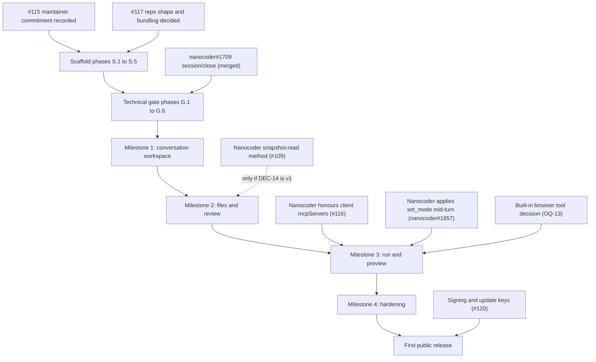

# Roadmap

Where Nanocoder Desktop is in the NC process, and the build broken into small phases with checklists, from scaffold to the first public release. No dates: no source gives one.

- Status: Draft
- Last updated: 2026-10-29
- Drafted by: @akramcodez

## How to use this roadmap

- **Work in order.** Finish one phase before starting the next, unless the phase says it can run in parallel.
- **Two checklists per phase.** "Build" lists what to make. "Results we want" lists what must be true before the phase counts as done.
- **Tick a box only when it is verified.** A result is verified when a test, a recorded manual check or a merged pull request shows it. Link the evidence next to the box when you tick it.
- **One phase, one or a few pull requests.** Reference the phase number and the requirement IDs in each pull request.
- **Blocked phases wait.** If a phase lists an open question, do not start the build items that depend on it until the answer is recorded in [`decisions.md`](decisions.md).
- **Milestone exits are the real gate.** A milestone is done only when its exit checklist is fully ticked on macOS, Windows and Linux.

## Where the project is

| Stage ([How a project comes to life][lifecycle]) | State |
|---|---|
| Stage 1, whitepaper draft | Merged in [#107][pr107] on 2026-10-01. |
| Stage 2, public review | Opened 2026-10-04 with a 3 November close ([commit][window]); closed early at approval. |
| Stage 3, build approval | `Build approved` on 2026-10-12 ([commit][approval]). No dated rationale on the page yet (`OQ-21`). |
| Stage 4, build and ship | Blocked by two prerequisites @will-lamerton set: maintainer commitment recorded on the whitepaper page ([#115][i115]) and the repository shape and bundling decision ([#117][i117]). The repository exists anyway (`OQ-20`). |

Stage 4 also means public from day one, with a README saying the project is pre-v0.1 and stability is not promised ([lifecycle][lifecycle]).

## Dependencies

The Nanocoder `mcpServers` change must land before Milestone 3 can exit (`DEC-13`).

## Before the build: Stage 4 prerequisites

These are process steps, not code. They are decided by @will-lamerton and the NC core team.

- [ ] Maintainer commitment recorded on the whitepaper page ([#115][i115])
- [ ] Repository shape and Nanocoder bundling decided and recorded on the whitepaper page ([#117][i117])
- [ ] The existing `Nano-Collective/nanocoder-desktop` repository confirmed as the one to build in (`OQ-20`)
- [ ] Planning set reviewed and merged into the repository
- [ ] The issues in [`proposed-issues.md`](proposed-issues.md) raised and linked from [`open-questions.md`](open-questions.md)

## Scaffold

Everything in [`repo-setup.md`](repo-setup.md). Run before the technical gate.

### Phase S.1: repository basics

**Build**

- [x] `LICENSE` (MIT, copyright "Nano Collective") ([`LICENSE`](../LICENSE))
- [x] `CONTRIBUTING.md` linking the Code of Conduct, Economics Charter and `MAINTAINING.md` ([`CONTRIBUTING.md`](../CONTRIBUTING.md))
- [x] `README.md` following the brand pattern, replacing the empty file ([`README.md`](../README.md))
- [x] `CODEOWNERS` with `* @Nano-Collective/core-team` ([`CODEOWNERS`](../.github/CODEOWNERS))
- [x] `AGENTS.md` for coding agents, and a `CLAUDE.md` containing `@AGENTS.md`, as nanocoder, get-md, docs and taskforest do ([`AGENTS.md`](../AGENTS.md), [`CLAUDE.md`](../CLAUDE.md))
- [x] Bug report, feature request and pull request templates ([`.github/`](../.github))
**Results we want**

- [x] README opens with the project name, the canonical tagline and a pre-v0.1 note ([`README.md`](../README.md))
- [x] CONTRIBUTING links rather than restates NC policy ([`CONTRIBUTING.md`](../CONTRIBUTING.md))
### Phase S.2: toolchain

**Build**

- [x] `package.json` with pnpm 11, Node `>=22`, ESM and the full script contract ([`package.json`](../package.json))
- [x] `tsconfig.json` with `strict` and the `@/*` to `source/*` alias ([`tsconfig.json`](../tsconfig.json))
- [x] `biome.json` copied from Nanocoder, with `.changeset/pre.json` excluded ([`biome.json`](../biome.json))
- [x] Husky and lint-staged ([`pre-commit`](../.husky/pre-commit))
- [x] `knip.json` with `semgrep` in `ignoreBinaries` ([`knip.json`](../knip.json))
- [x] AVA through `tsx`, serial, with c8 at 80% lines ([`package.json`](../package.json))
- [x] `pnpm-workspace.yaml` resolution policy (`SEC-18`) ([`pnpm-workspace.yaml`](../pnpm-workspace.yaml))
**Results we want**

- [x] `pnpm test:all` passes on a single smoke spec: it now passes on every pull request in the shared `pr-checks`
- [x] A staged badly formatted file is fixed on commit: checked on 2026-10-28 by staging an unformatted file and running lint-staged ([`pre-commit`](../.husky/pre-commit))
### Phase S.3: Electron skeleton

Uses the choices decided in [#3](https://github.com/Nano-Collective/nanocoder-desktop/issues/3) ([`tech-stack.md`](tech-stack.md#electron-specific-choices)).

**Build**

- [x] `electron-vite` and `electron-builder` set up, building to `out/` and `release/` ([`electron.vite.config.ts`](../electron.vite.config.ts), [`electron-builder.yml`](../electron-builder.yml))
- [x] Main, preload and renderer entry points in the `source/` layout ([`source/`](../source))
- [x] Hardened app renderer: sandbox, context isolation, no Node, custom protocol, Content Security Policy (`SEC-01`, `SEC-15`) ([`index.ts`](../source/main/index.ts), [`security.ts`](../source/main/security.ts))
- [x] Navigation and new-window requests denied in the app renderer ([`app.e2e.ts`](../e2e/app.e2e.ts))
**Results we want**

- [x] The app starts and shows an empty shell on macOS, Windows and Linux: the End to End job passes on all three platforms on every push to `main` ([`desktop-checks.yml`](../.github/workflows/desktop-checks.yml))
- [x] A spec proves the renderer cannot reach Node or navigate away ([`app.e2e.ts`](../e2e/app.e2e.ts))
- [x] Playwright launches a test build (with `nodeCliInspect` on) on all three platforms: the End to End job, all three platforms
- [ ] `node:sqlite` works in the Electron main process; native `.node` files are unpacked from the `asar` archive: `node:sqlite` works ([`app.e2e.ts`](../e2e/app.e2e.ts)); unpacking `.node` files is configured in `asarUnpack` but untested until a native module arrives
### Phase S.4: CI and release scaffolding

**Build**

- [x] `pr-checks.yml` caller with `validate-changesets: true` ([`pr-checks.yml`](../.github/workflows/pr-checks.yml))
- [x] Local macOS and Windows unit jobs, each on Node 22 and 24 ([#10](https://github.com/Nano-Collective/nanocoder-desktop/issues/10)) ([`desktop-checks.yml`](../.github/workflows/desktop-checks.yml))
- [x] ACP integration job on all three platforms, with its own test pattern and script, against a cached Nanocoder `main` build ([`desktop-checks.yml`](../.github/workflows/desktop-checks.yml))
- [x] Package smoke job behind a job-level condition, with Xvfb on Linux and `macos-15-intel` for the x64 build ([`desktop-checks.yml`](../.github/workflows/desktop-checks.yml))
- [x] End-to-end job (advisory), switched on for every pull request once Milestone 1 starts: it runs on pushes to `main` and, since 2026-10-28, on pull requests too, ahead of Milestone 1 ([`desktop-checks.yml`](../.github/workflows/desktop-checks.yml), `DEC-37`)
- [x] Actions pinned by commit SHA: every `uses:` in the workflows is pinned
- [x] `nc-review.yml` and `.github/nc-review/rubric.md` ([`nc-review.yml`](../.github/workflows/nc-review.yml), [`rubric.md`](../.github/nc-review/rubric.md))
- [x] Changesets scaffold with `changeset pre enter alpha` and `pre.json` committed ([`pre.json`](../.changeset/pre.json))
- [x] `release-prepare.yml`, `changeset-check.yml`, `update-badges.yml` ([`workflows`](../.github/workflows))
**Results we want**

- [x] All six prefixed required checks report green on a test pull request: green on every pull request from [#18](https://github.com/Nano-Collective/nanocoder-desktop/pull/18) to [#21](https://github.com/Nano-Collective/nanocoder-desktop/pull/21)
- [ ] Both rulesets applied in `evaluate` mode, then `active`: applied in `evaluate` mode, not yet `active`; going active ends direct pushes to `main`
- [ ] The first Version Packages pull request proposes an `alpha` version, not a stable one: not yet seen, because no changeset has been added
- [ ] Job times on macOS and Windows recorded; flake rate reviewed after two weeks: not yet done
### Phase S.5: IPC foundation

**Build**

- [x] Shared IPC types module ([`ipc.ts`](../source/shared/ipc.ts))
- [x] Runtime schema validation and sender checks for every handler (`SEC-02`) ([`handle-request.ts`](../source/main/ipc/handle-request.ts))
- [x] One result shape and the error codes in [`architecture.md`](architecture.md#ipc-contract-principles) ([`ipc.ts`](../source/shared/ipc.ts))
- [x] One sample method wired end to end: `app:get-info` ([`app.e2e.ts`](../e2e/app.e2e.ts))
**Results we want**

- [x] A malformed request is rejected with `VALIDATION` in a spec ([`handle-request.spec.ts`](../source/main/ipc/handle-request.spec.ts))
- [x] A request from an unexpected sender is rejected in a spec ([`handle-request.spec.ts`](../source/main/ipc/handle-request.spec.ts))
## Technical gate

Decided ([whitepaper, Next steps][wp-next]): prove the ACP boundary before Milestone 1. Exit when durable continuation works end to end.

### Phase G.1: find and launch Nanocoder safely

Published Nanocoder 1.31.0 lacks `session/close`, the trust check and per-session `cwd`; until the next release, use a build of Nanocoder `main` ([`acp-integration.md`](acp-integration.md#supported-nanocoder-versions)).

**Build**

- [x] Resolve the installed Nanocoder package to an absolute Node runtime and `dist/cli.js` (`REL-01`) ([`runtime.ts`](../source/main/nanocoder/runtime.ts))
- [x] Show the resolved paths and version to the user ([`app.tsx`](../source/renderer/app.tsx))
- [x] Launch with an argument array and no shell (`ACP-01`, `SEC-05`) ([`launch.ts`](../source/main/nanocoder/launch.ts), [`launch.spec.ts`](../source/main/nanocoder/launch.spec.ts))
**Results we want**

- [x] A `nanocoder` inside the project's own `node_modules` is refused ([`runtime.spec.ts`](../source/main/nanocoder/runtime.spec.ts))
- [x] Windows launches without going through the `.cmd` wrapper: the wrapper is parsed, never run ([`runtime.spec.ts`](../source/main/nanocoder/runtime.spec.ts)), and the Windows ACP job launches `node` with `cli.js`### Phase G.2: connect over ACP

**Build**

- [x] Spawn `--acp` in the canonical project root ([`acp-client.spec.ts`](../source/main/nanocoder/acp-client.spec.ts), [`connect.e2e.ts`](../e2e/connect.e2e.ts))
- [x] `initialize` with read-only client capabilities (`ACP-02`) ([`acp-client.spec.ts`](../source/main/nanocoder/acp-client.spec.ts))
- [x] Protocol-only stdout handling (`ACP-15`) ([`protocol-stream.spec.ts`](../source/main/nanocoder/protocol-stream.spec.ts))
- [x] Bounded, redacted stderr ring (`ACP-16`) ([`stderr-ring.spec.ts`](../source/main/nanocoder/stderr-ring.spec.ts))

**Results we want**

- [x] Capabilities and version are recorded for the connected Nanocoder ([`acp-client.acp.ts`](../source/main/nanocoder/acp-client.acp.ts), run on Linux against Nanocoder `8a5f4d4` on 2026-10-27)
- [x] An untrusted folder shows Nanocoder's own refusal message ([`acp-client.acp.ts`](../source/main/nanocoder/acp-client.acp.ts), same run; [`connect.e2e.ts`](../e2e/connect.e2e.ts))

### Phase G.3: settle trust and starting mode

`OQ-14` and `OQ-15` have proposals: `DEC-30` ([Directory trust](acp-integration.md#directory-trust)) and `DEC-31` ([Session mode](acp-integration.md#session-mode)).

**Build**

- [x] Trust launch: after the user confirms, start Nanocoder once with `NANOCODER_TRUST_DIRECTORY=1` and stdin closed, then launch without it (`ACP-20`, `DEC-30`) ([`trust.spec.ts`](../source/main/nanocoder/trust.spec.ts), [`acp-client.acp.ts`](../source/main/nanocoder/acp-client.acp.ts))
- [x] Recognise Nanocoder's trust refusals and show its reason with the prompt again, with no automatic restart (`ACP-20`, `ACP-17`) ([`open-project.spec.ts`](../source/main/nanocoder/open-project.spec.ts), [`connect.e2e.ts`](../e2e/connect.e2e.ts))
- [x] A minimal trust confirmation that shows Nanocoder's reason and the folder; the full list of what will run comes in phase 1.2 (`CHAT-02`) ([`connect.e2e.ts`](../e2e/connect.e2e.ts))
- [x] Raise the Nanocoder issue for a trust status command, a fingerprint-bound grant, a refusal exit code and a versioned fingerprint ([nanocoder#1899](https://github.com/Nano-Collective/nanocoder/issues/1899))
- [x] A minimal `session/new` at the project root, so there is a session to set the mode on (`ACP-05`) ([`acp-client.spec.ts`](../source/main/nanocoder/acp-client.spec.ts), [`acp-client.acp.ts`](../source/main/nanocoder/acp-client.acp.ts))
- [x] Send `session/set_mode` after every `session/new`, checked against `availableModes`, and block prompts until it succeeds; G.5 calls the same step after `session/resume` (`ACP-13`, `DEC-31`) ([`acp-client.spec.ts`](../source/main/nanocoder/acp-client.spec.ts))
- [x] Add the mode changes to [#12](https://github.com/Nano-Collective/nanocoder-desktop/issues/12): `--mode` for ACP, an error for unknown modes, the applied mode reported ([nanocoder#1900](https://github.com/Nano-Collective/nanocoder/issues/1900)); the effective approval policy waits for Milestone 3

**Results we want**

- [x] Both decisions recorded in [`decisions.md`](decisions.md) (`DEC-30`, `DEC-31`)
- [x] A changed fingerprint makes `--acp` exit with a reason the desktop shows ([`acp-client.acp.ts`](../source/main/nanocoder/acp-client.acp.ts), run on Linux against Nanocoder `8a5f4d4` on 2026-10-27)
- [x] `NANOCODER_TRUST_DIRECTORY` is never in the environment of a running session ([`launch.spec.ts`](../source/main/nanocoder/launch.spec.ts), [`open-project.spec.ts`](../source/main/nanocoder/open-project.spec.ts))
- [x] A session takes no prompt until `session/set_mode` succeeds, and a mode missing from `availableModes` is never sent ([`acp-client.spec.ts`](../source/main/nanocoder/acp-client.spec.ts))

The two checks that need a real turn moved to G.4 and G.5: a protected tool call producing a permission request, and plugins loading at the project root.

### Phase G.4: a real turn with approvals

**Build**

- [x] `session/new` with a provider-backed model (`ACP-05`) ([`turn.acp.ts`](../source/main/nanocoder/turn.acp.ts))
- [x] A scripted model provider for the ACP integration tests, so turns run in CI without an API key ([`testing-strategy.md`](testing-strategy.md)) ([`scripted-provider.ts`](../source/main/nanocoder/fixtures/scripted-provider.ts))
- [x] A prompt that triggers a protected tool (`execute_bash`, which always asks) ([`turn.acp.ts`](../source/main/nanocoder/turn.acp.ts))
- [x] Permission requests answered from a minimal UI (`ACP-10`) ([`permissions.spec.ts`](../source/main/nanocoder/permissions.spec.ts), [`connect.e2e.ts`](../e2e/connect.e2e.ts))

**Results we want**

- [x] Allow once runs the tool ([`turn.acp.ts`](../source/main/nanocoder/turn.acp.ts), [`connect.e2e.ts`](../e2e/connect.e2e.ts))
- [x] Reject stops the tool and the turn continues as Nanocoder reports: the tool is marked `failed`, the model is told "Tool call denied by user", and the turn ends with `end_turn` ([`turn.acp.ts`](../source/main/nanocoder/turn.acp.ts))
- [x] After `session/set_mode` to `normal`, a protected tool call in a new session produces a permission request, since Nanocoder does not report the applied mode (`DEC-31`): a file edit asks in `normal` and runs without asking in `auto-accept`; `execute_bash` asks in every mode, so it cannot show this ([`turn.acp.ts`](../source/main/nanocoder/turn.acp.ts))
- [x] Plugins load for a session at the project root (`DEC-30`) ([`turn.acp.ts`](../source/main/nanocoder/turn.acp.ts))

### Phase G.5: restart and resume

**Build**

- [x] End both processes, restart, `session/resume` (`ACP-06`, `ACP-07`) ([`resume.acp.ts`](../source/main/nanocoder/resume.acp.ts), [`acp-client.spec.ts`](../source/main/nanocoder/acp-client.spec.ts))
- [x] Missing-session path (`ACP-19`) ([`resume.acp.ts`](../source/main/nanocoder/resume.acp.ts), [`acp-client.spec.ts`](../source/main/nanocoder/acp-client.spec.ts))

**Results we want**

- [x] A follow-up question that only earlier context can answer is answered correctly: shown by the earlier exchange reaching the model; a real model's answer is the manual restart test ([`resume.acp.ts`](../source/main/nanocoder/resume.acp.ts))
- [x] Resuming a deleted session fails cleanly ([`resume.acp.ts`](../source/main/nanocoder/resume.acp.ts))
- [x] A protected tool call in a resumed session produces a permission request, because the mode is sent again after `session/resume` (`DEC-31`): a file edit asks in `normal` and runs without asking in `auto-accept` ([`resume.acp.ts`](../source/main/nanocoder/resume.acp.ts))
- [x] Passes on macOS, Windows and Linux, with a short write-up committed: [`technical-gate.md`](technical-gate.md), and the ACP job on [#20](https://github.com/Nano-Collective/nanocoder-desktop/pull/20) passes on all three

### Phase G.6: measure the runtime

Can run in parallel with G.4 and G.5. Proposed in `DEC-38`: public builds bundle a Node sidecar, so this phase confirms the numbers rather than choosing from scratch.

**Build**

- [x] Run Nanocoder under Electron's Node mode on all three platforms (Electron 45 embeds Node 24.22.0) ([`measure-runtime.mjs`](../scripts/measure-runtime.mjs), the ACP job on [#21](https://github.com/Nano-Collective/nanocoder-desktop/pull/21), [`technical-gate.md`](technical-gate.md#the-runtime-g6))
- [x] Run it under a bundled Node 22 sidecar on all three platforms, with the checksum of the official download verified for each OS and architecture ([`node-sidecar.json`](../scripts/node-sidecar.json), [`runtime.spec.mjs`](../scripts/lib/runtime.spec.mjs), the ACP job on [#21](https://github.com/Nano-Collective/nanocoder-desktop/pull/21)); macOS x64 is pinned but was not run
- [ ] Record the installer size the sidecar adds, and the macOS entitlements the bundled Node needs under the hardened runtime: the unpacked and download sizes are recorded; the entitlement test was inconclusive under ad hoc signing and needs the real identity in phase 4.2
- [ ] Run a turn on a machine without Node installed, and note what MCP servers or hooks that call `node`, `npm` or `npx` need: `initialize` works with no `node` on `PATH` on all three platforms; a full turn and the MCP and hook notes are still to do

**Results we want**

- [x] `PERF-02` startup time, idle memory and any failures recorded for both on all three platforms ([`technical-gate.md`](technical-gate.md#the-runtime-g6))
- [ ] The numbers recorded in [`technical-gate.md`](technical-gate.md) and posted on the work list ([#17](https://github.com/Nano-Collective/nanocoder-desktop/issues/17)), and the runtime change from the whitepaper's default recorded upstream (`DEC-38`)

## Milestone 1: conversation workspace

**Goal.** Trusted projects, durable threads, streaming and approvals, model and mode controls, process errors and bounded subagent runs ([whitepaper][wp-next]).

**Blockers.** Technical gate; `OQ-03`, `OQ-19`. **Risks.** `RISK-04`, `RISK-05`, `RISK-06`, `RISK-11`, `RISK-14`.

### Phase 1.1: desktop store

`node:sqlite`, with `better-sqlite3` as the fallback behind the same interface (`DEC-04`).

**Build**

- [x] SQLite connection in the main process (`DATA-01`) ([`store.e2e.ts`](../e2e/store.e2e.ts), profile ownership, `userData` and Electron's bundled Node)
- [x] Tables from [`data-model.md`](data-model.md) (`DATA-02`) ([`store.spec.ts`](../source/main/store/store.spec.ts), schema introspection, metadata round trips and cascades)
- [x] Numbered migrations with a backup before upgrade (`DATA-03`) ([`store.spec.ts`](../source/main/store/store.spec.ts), [`store.e2e.ts`](../e2e/store.e2e.ts))
- [x] Integrity check and recovery on startup (`DATA-08`) ([`store.spec.ts`](../source/main/store/store.spec.ts), [`store.e2e.ts`](../e2e/store.e2e.ts))
- [x] Settings and UI state storage (`DATA-09`, `DATA-10`) ([`store.spec.ts`](../source/main/store/store.spec.ts), [`store.e2e.ts`](../e2e/store.e2e.ts), restart persistence and patch refusals)

**Results we want**

- [x] Migrations run from an empty database and from the previous version ([`store.spec.ts`](../source/main/store/store.spec.ts), versions 0 and 1 to 2, concurrent upgrade rechecks and newer-but-corrupt refusal)
- [x] A corrupt database is moved aside and the app still starts ([`store.e2e.ts`](../e2e/store.e2e.ts), preserved corrupt bytes and fresh settings)
- [x] No table has a column for message text, file contents or tool output (`DATA-04`) ([`store.spec.ts`](../source/main/store/store.spec.ts), introspection over every migrated table; [`connect.e2e.ts`](../e2e/connect.e2e.ts), no conversation or tool text in SQLite)

### Phase 1.2: projects and trust

**Build**

- [x] Add a project through a main-process folder picker (`CHAT-01`) ([`project-service.spec.ts`](../source/main/projects/project-service.spec.ts), [`projects.e2e.ts`](../e2e/projects.e2e.ts), native selection and cancellation)
- [x] Store the canonical root, session cwd and display name ([`project-service.spec.ts`](../source/main/projects/project-service.spec.ts), [`projects.e2e.ts`](../e2e/projects.e2e.ts), persistence across restart)
- [ ] Trust prompt before anything project-defined runs, listing what Nanocoder will run (`CHAT-02`, `SEC-17`, `DEC-30`): native execution-sensitive consent and snapshot checks are implemented ([`project-consent.spec.ts`](../source/main/projects/project-consent.spec.ts), [`trust-summary.spec.ts`](../source/main/projects/trust-summary.spec.ts)); the proposal and upstream pre-trust/atomic-grant gaps remain open ([trust notes](projects-and-trust.md#pre-trust-probe-exception-and-upstream-gaps))
- [x] Recent projects list and "locate" for a moved project ([`projects.e2e.ts`](../e2e/projects.e2e.ts), ID-based opening, missing-folder explanation and relocation)

**Results we want**

- [x] Adding a folder through a symlink stores its real path ([`project-service.spec.ts`](../source/main/projects/project-service.spec.ts), [`projects.e2e.ts`](../e2e/projects.e2e.ts))
- [ ] An untrusted project never starts Nanocoder, Git or watchers: the G.3 ACP probe exception remains; the desktop starts no Git, watcher or session before a ready verdict ([trust notes](projects-and-trust.md#pre-trust-probe-exception-and-upstream-gaps))

### Phase 1.3: Nanocoder supervisor

**Build**

- [x] One process per project, started at the canonical root ([`supervisor.spec.ts`](../source/main/nanocoder/supervisor.spec.ts), concurrent turns and event isolation in [`connect.e2e.ts`](../e2e/connect.e2e.ts))
- [x] Exit detection, limited restart with backoff (`ACP-17`) ([`supervisor-recovery.spec.ts`](../source/main/nanocoder/supervisor-recovery.spec.ts))
- [x] Idle shutdown that closes sessions first (`ACP-08`, `ACP-23`) ([`supervisor-recovery.spec.ts`](../source/main/nanocoder/supervisor-recovery.spec.ts))
- [x] Diagnostics view over the stderr ring, export only after review (`SEC-08`) ([`diagnostics-export.spec.ts`](../source/main/nanocoder/diagnostics-export.spec.ts), [`supervisor-recovery.e2e.ts`](../e2e/supervisor-recovery.e2e.ts))

**Results we want**

- [x] Killing Nanocoder marks the running thread Failed and offers retry ([`supervisor-recovery.e2e.ts`](../e2e/supervisor-recovery.e2e.ts))
- [x] A crash loop stops after the retry limit and waits for the user ([`supervisor-recovery.spec.ts`](../source/main/nanocoder/supervisor-recovery.spec.ts), [`supervisor-recovery.e2e.ts`](../e2e/supervisor-recovery.e2e.ts))
- [x] Exported diagnostics contain no keys or tokens (`SEC-07`) ([`stderr-ring.spec.ts`](../source/main/nanocoder/stderr-ring.spec.ts), [`stderr-security.spec.ts`](../source/main/nanocoder/stderr-security.spec.ts))

### Phase 1.4: capability gates and version policy

**Build**

- [x] Feature gates from `initialize`, version and probes (`ACP-03`) ([`capabilities.spec.ts`](../source/main/nanocoder/capabilities.spec.ts), safe extension probes in [`acp-client.spec.ts`](../source/main/nanocoder/acp-client.spec.ts))
- [x] Supported version range check (`ACP-04`) ([`version-policy.spec.ts`](../source/main/nanocoder/version-policy.spec.ts), provisional minimum and untested-version warning documented in [`acp-integration.md`](acp-integration.md#supported-nanocoder-versions))
- [x] Visible reasons for every disabled feature (`CHAT-15`) ([`connect.e2e.ts`](../e2e/connect.e2e.ts), nine feature reasons and version warning)

**Results we want**

- [x] An older Nanocoder shows the right features turned off, each with a reason ([`connect.e2e.ts`](../e2e/connect.e2e.ts), fake 1.32.0 with no optional capabilities)
- [x] A version below the minimum is refused with a clear message ([`version-policy.spec.ts`](../source/main/nanocoder/version-policy.spec.ts), package and negotiated-version refusal in [`supervisor.spec.ts`](../source/main/nanocoder/supervisor.spec.ts), visible upgrade message in [`connect.e2e.ts`](../e2e/connect.e2e.ts))

### Phase 1.5: threads

**Build**

- [ ] New thread through `session/new`, session ID stored first (`CHAT-04`)
- [ ] Thread list by last activity, with archive (`CHAT-03`, `CHAT-13`)
- [ ] Titles from `_nanocoder/sessionTitleChanged` and rename (`CHAT-12`)
- [ ] Remove from desktop, and delete chat history with confirmation (`CHAT-14`, `DATA-07`)

**Results we want**

- [ ] A crash right after `session/new` still leaves a thread that resumes
- [ ] A rename survives a restart
- [ ] Removing a thread does not delete the Nanocoder session unless asked

### Phase 1.6: streaming conversation

**Build**

- [ ] Projection of every `session/update` type into thread events (`CHAT-05`)
- [ ] Ordered, batched events from main to renderer
- [ ] Defensive parsing of vendor fields (`ACP-12`)
- [ ] Usage display and custom slash commands (`CHAT-19`, `CHAT-20`)

**Results we want**

- [ ] A long streaming turn meets `PERF-04`
- [ ] Unknown `_meta` keys are ignored without errors
- [ ] Nanocoder's VS Code-specific `/help` text is not shown as desktop help

### Phase 1.7: approvals and cancel

**Build**

- [x] Permission requests with Nanocoder's own options (`CHAT-06`, `ACP-10`) ([`approvals.e2e.ts`](../e2e/approvals.e2e.ts), exact offered IDs and labels; [`permissions.spec.ts`](../source/main/nanocoder/permissions.spec.ts), main-process refusals)
- [x] Cancel, including during a pending permission (`CHAT-07`, `ACP-09`) ([`approvals.e2e.ts`](../e2e/approvals.e2e.ts), pending and active-turn cancellation; [`thread-service.spec.ts`](../source/main/threads/thread-service.spec.ts), strict main-owned scope and awaited settlement; [`workspace.spec.ts`](../source/main/ipc/workspace.spec.ts), renderer session-identity refusal before service invocation)
- [x] `ask_user` as selectable options (`CHAT-21`) ([`approvals.e2e.ts`](../e2e/approvals.e2e.ts), selection-only question and exact selected answer ID)

**Results we want**

- [x] Allow once, allow always and reject all behave as Nanocoder reports when offered ([`approvals.e2e.ts`](../e2e/approvals.e2e.ts), all four kinds with the fake; pinned Nanocoder offers only Allow and Deny, as recorded in [approval notes](approvals-and-cancel.md#permission-ownership))
- [x] Cancelling while a permission is pending ends the turn as Interrupted ([`approvals.e2e.ts`](../e2e/approvals.e2e.ts), every queued permission cancelled, no tool allowed and next turn available)

### Phase 1.8: durable resume and view-only

**Build**

- [ ] Resume through `session/resume` with full replay (`CHAT-08`, `ACP-06`, `ACP-07`)
- [ ] View-only threads with a reason and recovery actions (`CHAT-09`, `ACP-19`)
- [ ] Session discovery and import with native exact-root matching (`ACP-18`, `DEC-34`)

**Results we want**

- [ ] A thread continues with its context after the app and Nanocoder restart
- [ ] A thread whose session file was deleted opens view-only and says why
- [ ] Exact-root CLI sessions are offered for explicit import by an already-ready connection; nested folders are intentionally excluded because they may have a separate configuration or trust scope (`DEC-34`). Listing is best-effort and may omit path aliases.

### Phase 1.9: controls and the one-root-turn rule

**Build**

- [ ] Model and provider controls labelled as project-wide (`CHAT-10`, `ACP-14`)
- [ ] Mode control, set between turns only, with an explicit project default and a confirmation for `yolo` (`CHAT-11`, `ACP-13`, `DEC-31`)
- [ ] One root turn per project process (`CHAT-17`)

**Results we want**

- [ ] Prompting a second thread while one runs is refused with `BUSY` and a reason
- [ ] Model and mode controls are disabled while a turn runs
- [ ] A model change is visible in every thread of the project

### Phase 1.10: subagents

**Build**

- [x] Supported `agent` source shapes render flat run cards and literal title progress (`SUB-01`, `SUB-02`), with truthful missing depth/elapsed/child detail ([implementation](subagents.md), [`subagents.spec.ts`](../source/renderer/subagents.spec.ts), [`subagents.e2e.ts`](../e2e/subagents.e2e.ts))
- [x] Subagent approvals carry bounded display attribution in the existing queue (`SUB-03`), without guessing a parent from a shared name; approved is not successful ([`permissions.spec.ts`](../source/main/nanocoder/permissions.spec.ts), [`subagents.acp.ts`](../source/main/nanocoder/subagents.acp.ts))
- [x] Stop cancels the entire turn and says so (`SUB-04`), including all pending permissions; known interrupted/failed display outcomes remain on their cards ([`subagents.e2e.ts`](../e2e/subagents.e2e.ts))
- [x] Informational bounds and safe tool-card fallback when child details are missing (`SUB-06`, `SUB-07`), without a fabricated tree or child action ([implementation](subagents.md))
- [ ] `agent_run` rows per actual run (`SUB-05`): phase 1.8 composes stable main-owned live/replay identities and atomic safe run metadata commits, with a fake whole-app/child restart proof. Independent full phase 1.8/SUB-05 acceptance remains pending ([implementation and limits](subagents.md#sub-05-remains-pending), [replay and renderer gates](durable-replay.md)).

**Results we want**

- [x] A supported delegated task shows its reported role, task/progress and attributed approvals, without guessed parent linkage ([`subagents.e2e.ts`](../e2e/subagents.e2e.ts), pinned real ACP allow/deny/cancel in [`subagents.acp.ts`](../source/main/nanocoder/subagents.acp.ts))
- [x] Stopping from a card ends the whole turn as Interrupted ([`subagents.e2e.ts`](../e2e/subagents.e2e.ts)); per-child stop, a true tree and `OQ-03` remain open (`SUB-08`)

### Milestone 1 exit

- [ ] `SP-02` passes on macOS, Windows and Linux
- [ ] `SP-03` passes on macOS, Windows and Linux
- [ ] `SP-04` passes on macOS, Windows and Linux
- [ ] `SP-05` passes on macOS, Windows and Linux (whole-turn stop unless `SUB-08` lands)
- [ ] `SP-06` passes on macOS, Windows and Linux
- [ ] The conversation meets `A11Y-01` to `A11Y-05` (`CHAT-18`)
- [ ] `PERF-01` to `PERF-04` measured and within target, or the gap recorded with an issue
- [ ] Coverage at or above the floor, all required checks green

## Milestone 2: files and review

**Goal.** Lazy file browser, preview and editor handoff, chat attachments, real Git status and diffs, touched files and transient review comments ([whitepaper][wp-next]).

**Blockers.** `OQ-07`; the Nanocoder snapshot-read method for phase 2.9 only. **Risks.** `RISK-08`.

### Phase 2.1: path safety

**Build**

- [ ] Canonicalisation and containment module ([`security.md`](security.md#path-canonicalisation), `SEC-03`)
- [ ] Limits on entries, bytes and time (`SEC-04`)
- [ ] Link handling that never follows paths out of the root (`FILE-10`)

**Results we want**

- [ ] Traversal, symlink and junction escape tests pass on all three platforms
- [ ] Case and Unicode edge-case tests pass on case-insensitive volumes

### Phase 2.2: file tree

**Build**

- [ ] Lazy listing per directory with an entry limit (`FILE-01`, `FILE-09`)
- [ ] Ignored entries marked, `.git` contents hidden (`FILE-02`)
- [ ] Keyboard tree navigation with tree semantics (`FILE-11`)

**Results we want**

- [ ] A large real repository opens without loading the whole tree, and listings meet `PERF-05`
- [ ] A huge folder shows "more not shown" instead of hanging

### Phase 2.3: file preview

**Build**

- [ ] Text preview with syntax highlighting and a size limit (`FILE-04`)
- [ ] Metadata view for binary, unsupported and oversized files
- [ ] Encoding detection without rewriting files

**Results we want**

- [ ] Oversized and binary files never load their full content into the renderer
- [ ] Previews meet `PERF-06`
- [ ] Non-UTF-8 files are labelled, not corrupted

### Phase 2.4: watching and refresh

**Build**

- [ ] Debounced file watching (`FILE-05`)
- [ ] Manual refresh that reconciles the open tree
- [ ] Fallback when the platform watch limit is reached

**Results we want**

- [ ] Edits made outside the app appear without a manual refresh
- [ ] Hitting the Linux watch limit shows a notice and manual refresh still works

### Phase 2.5: files into the chat

**Build**

- [ ] ACP `fs/read_text_file` through the same checks (`ACP-11`, `SEC-20`)
- [ ] Insert a file into the composer as a resource (`FILE-08`, `CHAT-16`)

**Results we want**

- [ ] An ACP read outside the root is refused
- [ ] An inserted file reaches Nanocoder and is used in the answer

### Phase 2.6: Git service

**Build**

- [ ] Git detection and version display (`GIT-01`, `GIT-13`)
- [ ] Hardened invocation (`GIT-11`, `SEC-06`)
- [ ] NUL-delimited status parser (`GIT-02`)
- [ ] Git status on file tree entries (`FILE-03`)

**Results we want**

- [ ] A repository configured with `core.fsmonitor` or an external diff does not run them
- [ ] Parser tests cover renames, untracked files and names with spaces and newlines
- [ ] A non-Git project shows review as unavailable with a reason
- [ ] Status on the 100,000-file fixture meets `PERF-07`

### Phase 2.7: diff and review list

**Build**

- [ ] Staged and unstaged filters (`GIT-03`)
- [ ] Unified diff with binary, rename, add and delete states (`GIT-04`)
- [ ] Touched-this-turn labels (`GIT-05`)
- [ ] `HEAD` recorded before and after each turn, commits made during a turn listed (`GIT-12`)
- [ ] Refresh on file change and turn end (`GIT-06`)

**Results we want**

- [ ] After a turn, edited files are labelled as touched and show the real diff
- [ ] Changes the user made outside the agent appear too
- [ ] With Nanocoder's `autoCommit` on, the turn's commits are shown
- [ ] Diffs meet `PERF-08`

### Phase 2.8: review comments and handoff

**Build**

- [ ] Line range selection with a comment inserted into the composer (`GIT-07`)
- [ ] Open in editor and reveal in file manager (`GIT-08`, `FILE-06`, `FILE-07`)

**Results we want**

- [ ] A review comment reaches the next prompt and is not stored afterwards
- [ ] The chosen editor opens the right file on all three platforms

### Phase 2.9: agent changes view (only if `DEC-14` is accepted for v1)

**Build**

- [ ] Use the Nanocoder snapshot-read method once it exists (`GIT-09`)
- [ ] Fallback label when no snapshot exists (`GIT-10`)

**Results we want**

- [ ] In a file with earlier user edits, only the agent's changes appear in this view
- [ ] Binary and pruned snapshots fall back with a reason

### Milestone 2 exit

- [ ] `SP-07` passes on macOS, Windows and Linux
- [ ] `SP-08` passes on macOS, Windows and Linux
- [ ] `SP-09` passes on macOS, Windows and Linux
- [ ] Path security tests pass on all three platforms
- [ ] No destructive Git action exists in the app (`GIT-14`)

## Milestone 3: run and preview

**Goal.** One PTY, localhost handling, the isolated agent-controlled browser, browser data and download settings, and URL-to-chat context ([whitepaper][wp-next]).

**Blockers.** Nanocoder honours `mcpServers` ([#116][i116]); `DEC-15`; `OQ-06`, `OQ-11`, `OQ-13`, `OQ-17`; [nanocoder#1857][nc1857]. **Risks.** `RISK-03`, `RISK-09`, `RISK-10`, `RISK-12`.

### Phase 3.1: PTY host

`node-pty` with `@xterm/xterm` (`DEC-28`). Linux builds `node-pty` from source.

**Build**

- [ ] One PTY per active project in the canonical root (`TERM-01`)
- [ ] Shell discovery per platform, launched by absolute path (`TERM-03`, `TERM-10`)
- [ ] Interactive input with UTF-8 handling (`TERM-04`)

**Results we want**

- [ ] The user's shell starts in the project root on all three platforms
- [ ] A PTY crash does not take down the main process

### Phase 3.2: terminal lifecycle

**Build**

- [ ] Start, stop, restart and resize (`TERM-02`)
- [ ] Process tree teardown on stop, project switch and quit (`TERM-07`)
- [ ] Clear output and bounded in-memory scrollback (`TERM-06`, `TERM-09`)
- [ ] Keyboard escape from the terminal and screen-reader mode (`TERM-11`)
- [ ] Agent strip showing the agent's last shell command and its approval result (`TERM-12`)

**Results we want**

- [ ] Stopping a running dev server leaves no orphaned process on any platform
- [ ] Nothing from the terminal is written to disk

### Phase 3.3: browser view

Needs `OQ-06` answered.

**Build**

- [ ] `WebContentsView` with its own persistent partition (`BRW-01`, `BRW-05`)
- [ ] Sandbox on, no Node, no preload, no IPC (`SEC-12`)

**Results we want**

- [ ] A test page cannot reach any desktop API
- [ ] Browser data is stored apart from the user's normal browser

### Phase 3.4: navigation and origin policy

**Build**

- [ ] Address bar, back, forward, reload and stop (`BRW-02`)
- [ ] Origin and loading state exposed (`BRW-04`)
- [ ] Localhost by default, public sites behind a setting (`BRW-03`)

**Results we want**

- [ ] A public URL is refused until the setting is on
- [ ] A redirect from localhost to a public site stops and asks while the setting is off

### Phase 3.5: browser defaults and settings

**Build**

- [ ] Deny permissions, popups, external protocols and uploads (`BRW-07`, `SEC-10`)
- [ ] Downloads with destination confirmation (`BRW-06`)
- [ ] Clear browser data (`BRW-08`)
- [ ] Open current URL externally (`BRW-09`, `SEC-16`)

**Results we want**

- [ ] Camera, microphone, location and notification requests are denied without asking the user
- [ ] Clearing data removes cookies and history for the partition

### Phase 3.6: links into the browser and chat

**Build**

- [ ] Localhost URLs from terminal output and chat open in the in-app browser (`TERM-05`)
- [ ] Send the current URL and title to the chat (`BRW-10`)

**Results we want**

- [ ] Starting a dev server and opening its URL takes one action
- [ ] The URL and title arrive in the next prompt

### Phase 3.7: Nanocoder `mcpServers` support

Needs [#116][i116] merged in Nanocoder and `OQ-17` answered.

**Build**

- [ ] Confirm the Nanocoder change is released and gate it by version
- [ ] Pass the desktop's browser server in `mcpServers` on new and resumed sessions (`ACP-22`)
- [ ] Implement the agreed transport

**Results we want**

- [ ] The browser tool exists only in desktop sessions, not in the user's CLI sessions
- [ ] The user's MCP configuration files are untouched

### Phase 3.8: browser-control broker

**Build**

- [ ] Typed operations: open, back, reload, wait, snapshot, screenshot, click, type, scroll (`BRW-11`, `SEC-13`)
- [ ] Observations labelled as untrusted page data and size-bounded (`BRW-15`)
- [ ] Control advertised only when the server and view are ready (`BRW-17`)

**Results we want**

- [ ] The agent opens the local dev server, takes a snapshot and clicks a button
- [ ] No operation can run arbitrary JavaScript or reach the filesystem

### Phase 3.9: approvals and user control

Needs `DEC-15` agreed.

**Build**

- [ ] Desktop approvals for sensitive actions (`BRW-13`, `SEC-09`)
- [ ] Public-site control only in `normal` mode (`BRW-16`, `SEC-11`)
- [ ] Pause, interrupt and take control (`BRW-14`)
- [ ] Every action, observation and approval shown in the chat (`BRW-12`)

**Results we want**

- [ ] A form submission by the agent asks for approval first
- [ ] Public-site control is paused outside `normal` mode, with the reason shown
- [ ] The user can take over mid-action and the agent stops

### Phase 3.10: Nanocoder's own browser and external pages

Needs `OQ-13` answered.

**Build**

- [ ] Apply the agreed handling of Nanocoder's built-in `browser` tool (`BRW-18`)
- [ ] Pages that need the user's regular profile open externally without agent control (`BRW-20`)

**Results we want**

- [ ] With public browsing off, the agent cannot reach a public site through any browser tool
- [ ] The decision is recorded in [`decisions.md`](decisions.md)

### Milestone 3 exit

- [ ] `SP-10` passes on macOS, Windows and Linux
- [ ] `SP-11` passes on macOS, Windows and Linux
- [ ] Browser security tests in [`testing-strategy.md`](testing-strategy.md#security-tests) pass

## Milestone 4: hardening

**Goal.** Validate packaging, path security, ACP compatibility, crash recovery, browser security, large-project performance, accessibility and keyboard navigation on macOS, Windows and Linux ([whitepaper][wp-next]).

**Blockers.** `OQ-10`, `OQ-16`, `OQ-22`. **Risks.** `RISK-07`, `RISK-13`.

### Phase 4.1: runtime and bundling

**Build**

- [ ] Bundle a pinned Node sidecar with its verified checksum, and apply the Node version rule (`REL-04`, `DEC-38`)
- [ ] Bundle a pinned, tested Nanocoder with its checksum recorded (`REL-02`, `REL-11`)
- [ ] Advanced override for another Nanocoder (`REL-03`)

**Results we want**

- [ ] A fresh machine with no Nanocoder installed can run a turn
- [ ] The override works with a newer Nanocoder and gates missing features

### Phase 4.2: packaging

**Build**

- [ ] Installers for macOS (`.dmg` and `.zip`), Windows and Linux (`REL-05`)
- [ ] Fuses reviewed and set: `runAsNode`, `nodeOptions` and `nodeCliInspect` off in the shipped build, with reasons for any left on (`SEC-19`)
- [ ] Installers attached to GitHub Releases (`REL-12`)

**Results we want**

- [ ] Each installer installs, launches and uninstalls cleanly
- [ ] `PERF-09` and `PERF-10` recorded for each installer
- [ ] The shipped-build smoke test passes and confirms the fuses are set (`SEC-19`)
- [ ] A packaged test shows an inherited `NODE_OPTIONS` runs no extra script, and a turn runs on a machine without Node (`SEC-05`, `DEC-38`)

### Phase 4.3: notices and licences

**Build**

- [ ] Third-party notices generated from the lockfile, including the bundled Nanocoder (`REL-06`)

**Results we want**

- [ ] Nanocoder's copyright and MIT licence ship in every installer
- [ ] A CI check fails when notices are out of date

### Phase 4.4: signing and updates

Needs `OQ-10` answered.

**Build**

- [ ] Signing and notarisation in CI with the agreed key custody (`REL-07`, `SEC-14`)
- [ ] Signed auto-update on the agreed channel (`REL-08`)

**Results we want**

- [ ] macOS opens the app without a Gatekeeper block
- [ ] Windows installs without a SmartScreen warning
- [ ] An installed build updates itself to the next build

### Phase 4.5: ACP compatibility

**Build**

- [ ] Shared conformance tests running against the bundled and minimum Nanocoder versions (`ACP-21`)
- [ ] Gate results recorded per tested version (`ACP-04`)

**Results we want**

- [ ] Conformance passes for every supported version
- [ ] Results recorded for each supported version

### Phase 4.6: crash recovery and retention

Needs `OQ-16` answered.

**Build**

- [ ] Crash recovery tests for the app, Nanocoder and the PTY (`ACP-17`)
- [ ] Apply the agreed retention handling (`ACP-19`)

**Results we want**

- [ ] Every crash path in [`architecture.md`](architecture.md#crash-recovery) recovers or goes view-only with a reason
- [ ] Users are told how Nanocoder's retention affects old threads

### Phase 4.7: security review

**Build**

- [ ] Full security test suite on all platforms
- [ ] Electron checklist reviewed item by item ([`security.md`](security.md#electron-hardening-checklist))
- [ ] Supply-chain settings and pinning in place (`SEC-18`)

**Results we want**

- [ ] Every `SEC-` rule has a test or a recorded manual check
- [ ] Audit, Semgrep and CodeQL report no unresolved high findings

### Phase 4.8: large-project performance

**Build**

- [ ] Measure tree, status, diff and resume on a large real repository

**Results we want**

- [ ] `PERF-01` to `PERF-08` are met on the reference machine on all three platforms
- [ ] `PERF-09` and `PERF-10` are recorded for the release

### Phase 4.9: accessibility and keyboard

**Build**

- [ ] Keyboard-only pass over chat, files, review, terminal and browser (`CHAT-18`, `FILE-11`, `TERM-11`)
- [ ] Screen-reader pass on each platform's main screen reader

**Results we want**

- [ ] `A11Y-01` to `A11Y-05` pass across chat, files, review, terminal and browser
- [ ] `A11Y-06` screen-reader runs recorded for VoiceOver, NVDA and Orca
- [ ] Issues found are fixed or filed with a milestone

### Phase 4.10: first public release

**Build**

- [ ] Release flow through changesets in `alpha` mode (`REL-09`)
- [ ] Local `release.yml` building per platform
- [ ] Pre-v0.1 status stated in the README, release notes and the app (`REL-10`)
- [ ] Every box in the [launch checklist](repo-setup.md#launch-checklist)

**Results we want**

- [ ] The packaged restart-and-resume test passes with a real provider on all three platforms
- [ ] The first `alpha` release is published

### Milestone 4 exit

- [ ] `SP-01` to `SP-11` pass on packaged builds on macOS, Windows and Linux
- [ ] The launch checklist in [`repo-setup.md`](repo-setup.md#launch-checklist) is complete

## Later

Only after evidence ([whitepaper][wp-next]): multiple terminals; full-text thread and filename search; exact per-turn patch attribution (unless `DEC-14` brings it forward); stage, commit and branch actions; worktrees and independent parallel root agents; richer file previews; skills and configuration management UI; remote execution. Also later: browser annotations (`BRW-19`), the subagent run tree (`SUB-08`), "Open in Scriptura" and cross-app chat continuation ([#118][i118]).

[lifecycle]: https://docs.nanocollective.org/collective/projects/how-a-project-comes-to-life
[pr107]: https://github.com/Nano-Collective/docs/pull/107
[window]: https://github.com/Nano-Collective/docs/commit/60283a571f5536558a2becb17b973c3512cfad68
[approval]: https://github.com/Nano-Collective/docs/commit/7a7a6208c3235d03cf59b82634d712b4aa306a5f
[wp-next]: https://github.com/Nano-Collective/docs/blob/3ec3b1c6a21277556a9df3000f4e0f244e35e3bb/content/collective/whitepapers/nanocoder-desktop.md?plain=1#L650-L696
[i115]: https://github.com/Nano-Collective/docs/issues/115
[i116]: https://github.com/Nano-Collective/docs/issues/116
[i117]: https://github.com/Nano-Collective/docs/issues/117
[i118]: https://github.com/Nano-Collective/docs/issues/118
[nc1857]: https://github.com/Nano-Collective/nanocoder/issues/1857
