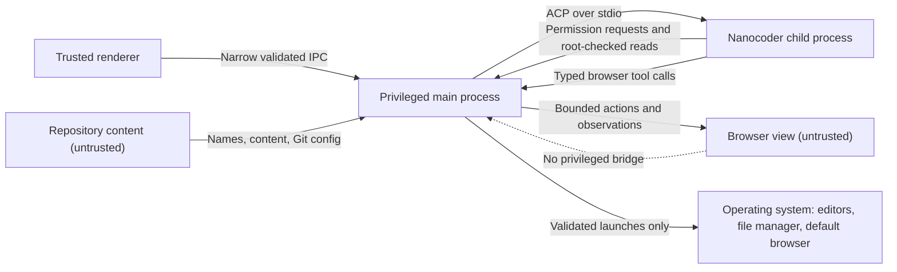

# Security

The threat model, trust boundaries and security rules for Nanocoder Desktop, including the browser-to-agent boundary and signing.

- Status: Draft
- Last updated: 2026-10-27
- Drafted by: @akramcodez

## Why this matters here

The desktop combines three powerful local capabilities in one application: filesystem access, process execution and rendering untrusted web content ([whitepaper, Threat model][wp-threat]). It also sits next to an agent that can edit files and run commands. Every rule below exists to keep those capabilities separate.

## Threat model

### In scope

From the whitepaper (Decided):

- a compromised renderer trying to call privileged desktop APIs;
- repository paths, symlinks or junctions escaping the trusted project root;
- an untrusted or PATH-shadowed Nanocoder executable;
- agent-initiated ACP file requests bypassing the file browser's checks;
- shell argument injection in Git or process launches;
- secrets appearing in transcripts, tool output, stderr or crash reports;
- remote pages requesting desktop privileges, popups, downloads or external protocols;
- prompt injection, sensitive-action abuse or cross-origin confusion through agent-controlled browser content.

Added by this plan, Suggestion (not discussed):

- **Repository-controlled execution.** A cloned repository can carry configuration that runs code when tools read it: Git's `core.fsmonitor`, external diff drivers and text conversion filters, and Nanocoder's own project hooks, MCP servers, custom tools and plugins. Nanocoder gates its part behind directory trust ([Nanocoder hooks docs][nc-hooks-trust]); the desktop gates its Git calls (`SEC-06`, `SEC-17`).
- **Hostile file names and content.** Names with control characters, bidirectional-override characters or extreme length, and very large or deeply nested trees, used to mislead the user or exhaust the desktop (`SEC-04`).
- **Prompt injection through Nanocoder's own web tools.** `fetch_url`, `web_search` and the built-in `browser` tool already bring web content into the agent today, independent of the desktop ([nanocoder#1626][nc1626]). The desktop must not widen that path (`OQ-13`).

### Out of scope

From the whitepaper (Decided): a compromised host operating system, a malicious user who explicitly chooses an unsafe executable, provider compromise, and vulnerabilities in Chromium, Node, Electron or Nanocoder themselves.

Clarified by this plan:

- **Nanocoder's own tool boundary.** The desktop's root checks govern what the desktop serves (its file browser, ACP `fs/read_text_file`, Git and the terminal). They do not limit Nanocoder's own file and shell tools, which follow Nanocoder's project boundary and approval policy. The desktop should never describe its checks as sandboxing the agent.
- **The user terminal.** The terminal runs whatever the user types, with the user's privileges (`TERM-08`).

## Trust boundaries

| Boundary | What crosses it | Control |
|---|---|---|
| Renderer to main | User intents | `SEC-01`, `SEC-02`, `SEC-15` |
| Main to Nanocoder | Process launch, ACP requests | `SEC-05`, `ACP-01` |
| Nanocoder to main | Permission requests, file reads, session updates | `SEC-09`, `SEC-20`, `ACP-10`, `ACP-11` |
| Nanocoder to browser broker | Browser tool calls | `SEC-11`, `SEC-13`, `BRW-13` |
| Broker to browser view | Navigation, input events, snapshots | `SEC-10`, `SEC-12` |
| Browser view to anything | Nothing privileged | `SEC-12` |
| Repository to main | File names, content, Git configuration | `SEC-03`, `SEC-04`, `SEC-06`, `SEC-17` |
| Main to operating system | Open in editor, reveal in file manager, open externally | `SEC-05`, `SEC-16` |

## Required rules

| ID | Rule | Status and source |
|---|---|---|
| SEC-01 | Every renderer that shows app UI runs sandboxed, with context isolation on, Node integration off, `webSecurity` on, and no experimental or Blink features enabled. | Decided ([whitepaper][wp-threat]); details from [Electron security guidance][el-security] |
| SEC-02 | Every IPC method is narrow, schema-validated in the main process and checks its sender frame. The preload exposes typed functions, never `ipcRenderer`. | Decided ([whitepaper][wp-threat]) |
| SEC-03 | Every file, Git and ACP path is canonicalised and checked against the canonical project root before use, including symlinks, Windows junctions and case-insensitive volumes (see [Path canonicalisation](#path-canonicalisation)). | Decided ([whitepaper][wp-threat]) |
| SEC-04 | Directory entries, preview bytes, diff size, ACP read size and time spent per request are all bounded. Hitting a limit returns `LIMIT` with a reason, never a partial result presented as complete. | Decided ([whitepaper, File browser][wp-files]); values are Suggestion (not discussed) |
| SEC-05 | Processes are launched only from displayed, trusted absolute paths with argument arrays and no shell. Nothing is resolved through `PATH` at launch time. | Decided ([whitepaper][wp-threat]) |
| SEC-06 | Git runs with an argument array, no pager, no external diff driver, no text conversion, and repository-configured execution hooks disabled for the read-only commands the desktop uses. | Decided (argument array, no pager, no external diff: [whitepaper][wp-git]); the rest is Suggestion (not discussed) |
| SEC-07 | Provider keys, OAuth credentials, transcripts and tool payloads never enter desktop storage, logs, telemetry or crash reports. | Decided ([whitepaper][wp-threat], [Distribution][wp-dist]) |
| SEC-08 | Diagnostics are bounded, redacted and reviewed by the user before they leave the machine. The desktop sends nothing automatically. | Decided ([whitepaper][wp-threat]); "nothing automatically" is Suggestion (not discussed) |
| SEC-09 | Protected Nanocoder tools are approved through Nanocoder's permission requests; sensitive browser actions are approved by the desktop. Neither approves anything on the user's behalf. | Decided (approvals, [whitepaper][wp-threat]); the split is Proposed (awaiting @will-lamerton) ([#108][i108]) |
| SEC-10 | The browser denies permissions, file uploads, popups and external protocols by default, and confirms every download's destination. | Decided ([whitepaper][wp-threat]) |
| SEC-11 | Page content is untrusted input. Agent actions are confined to the active tab and approved origins, and observations are labelled as page data. | Decided (confinement, [whitepaper][wp-threat]); labelling Proposed (awaiting @will-lamerton) ([#108][i108]) |
| SEC-12 | The browser view has no Node, no preload and no desktop IPC, runs sandboxed, and uses its own persistent partition. | Decided ([whitepaper, Security boundary][wp-browser-sec]) |
| SEC-13 | The browser-control adapter exposes typed actions only: no arbitrary JavaScript, raw CDP, filesystem, terminal or file-upload access. | Decided ([whitepaper, Architecture][wp-arch]) |
| SEC-14 | Releases are signed, updates are signed, and Electron and Chromium security releases are applied promptly. | Decided as a requirement ([whitepaper][wp-threat]); how is Open ([#120][i120]) |
| SEC-15 | The app UI loads only bundled code over a custom protocol (not `file://`), with a restrictive Content Security Policy. Navigation away from the app and new windows are denied in app UI renderers. | Suggestion (not discussed), from [Electron security guidance][el-security] items 7, 13, 14 and 18 |
| SEC-16 | `shell.openExternal` is called only for `http:` and `https:` URLs (and `mailto:` if needed), only after a user action, and never with a URL taken straight from page or model content without showing it first. | Suggestion (not discussed), from [Electron security guidance][el-security] item 15 |
| SEC-17 | The desktop runs nothing project-defined (Nanocoder sessions, Git status, file watchers that follow config) until the user has trusted the project. Opening an untrusted folder shows its tree name only. One exception, until Nanocoder can report trust without starting ([nanocoder#1899](https://github.com/Nano-Collective/nanocoder/issues/1899)): a pre-trust probe starts `nanocoder --acp` in the folder, which loads its `.env` before refusing and then exits without running a tool, hook or MCP server. | Proposed (awaiting @will-lamerton) (`DEC-30`) |
| SEC-18 | Dependencies pass `pnpm audit`, Semgrep and CodeQL in CI, the lockfile is frozen, Electron is pinned to an exact version, and GitHub Actions are pinned by commit SHA. | Decided (audit, Semgrep, CodeQL: [Project infrastructure][infra]); pinning is Suggestion (not discussed) |
| SEC-19 | Electron fuses are reviewed and set at packaging time. Any fuse left on (for example `runAsNode`, if Nanocoder runs under Electron's Node mode) is documented with its reason. Playwright needs `nodeCliInspect` on, so end-to-end tests use a test build with that fuse on, and a test checks the shipped build's fuses ([#3](https://github.com/Nano-Collective/nanocoder-desktop/issues/3)). | Suggestion (not discussed), from [Electron security guidance][el-security] item 19 and [fuses][el-fuses] |
| SEC-20 | ACP client callbacks get least privilege: root-checked text reads only, no writes, no terminal, and no reads of files the user excluded. | Decided ([whitepaper, Why ACP][wp-why]) |

## Browser-to-agent trust boundary

Raised by @akramcodez in [#108][i108]. The whitepaper calls page content untrusted but does not say how that stops a page from steering an agent that also has file, shell and Git tools.

### The proposal

Proposed (awaiting @will-lamerton), from @puri-adityakumar's [reply][i108-c]:

1. **Label page data.** Anything the agent reads from a page is labelled as page data, never presented as instructions from the user.
2. **Gate public sites on mode.** The agent can control public sites only while the session is in `normal` mode, where Nanocoder asks before file edits and shell commands. Localhost preview works in every mode.
3. **Split approvals.** Nanocoder approves workspace actions (file edits, shell commands, Git). The desktop approves browser actions. Neither approves anything on the user's behalf.
4. **Keep the browser subagent open.** A low-privilege browser subagent is attractive, but its summary could still carry injected text back to the main agent, so approvals are needed either way (`OQ-11`).

### What each layer owns

| Decision | Owner | Mechanism |
|---|---|---|
| Whether the agent may control public sites at all | User, through desktop settings | `BRW-03` (off by default) |
| Whether the current session may control public sites | Desktop | `BRW-16`: only in `normal` mode, once `DEC-15` is agreed |
| A sensitive browser action (submit, purchase, permission change, deletion, download) | User, asked by the desktop | `BRW-13` |
| A workspace action that follows browsing (edit, shell, Git) | User, asked by Nanocoder | Nanocoder's approval policy in the current mode |
| What the model reads | Desktop | `BRW-15`: labelled, bounded observations |

### Residual risk

- **Labels are not a control.** A model can follow labelled text. Labelling helps the model and the reader; the approval gates are the real control.
- **Modes are the weak point.** At Nanocoder `8a5f4d4`, ACP sessions start in `auto-accept`, where file edits apply without a prompt ([source][nc-mode]), and a mode change during a turn is not applied to that turn ([nanocoder#1857][nc1857]). The desktop must set the mode before the first turn (`ACP-13`) and must not enable public-site control in a session that is not in `normal` mode. Threads start in `normal`, and a thread takes no prompt until its mode is set (`DEC-31`). Even `normal` does not ask for tools in Nanocoder's `alwaysAllow`, which is checked before the mode ([source][nc-approval]).
- **Other web paths exist.** Nanocoder's `fetch_url`, `web_search` and built-in `browser` tools bring web content into the agent regardless of the desktop (`OQ-13`).

## Path canonicalisation

Applies to the file service, the Git service and ACP reads (`SEC-03`). Status: Decided in outline ([whitepaper, File browser][wp-files]); the steps below are Suggestion (not discussed).

1. **Canonicalise the root once.** When a project is added, resolve the chosen folder to its real path and store it. On every open, resolve it again. If it now points somewhere else (the folder was replaced by a link), stop and ask the user.
2. **Accept relative paths only.** Requests carry a path relative to the root. Reject absolute paths, empty segments, NUL bytes and, on Windows, drive-relative paths, UNC and `\\?\` prefixes, alternate data stream syntax (`name:stream`), reserved device names and trailing dots or spaces.
3. **Resolve, then contain.** Join the root and the relative path, resolve to a real path, and require the result to equal the root or start with the root plus a path separator.
4. **Compare per volume.** Case sensitivity is a property of the volume, not the operating system: default macOS and Windows volumes are case-insensitive, Linux usually is not, and any of them can mount the other kind. Compare accordingly, and normalise Unicode before comparing.
5. **Do not follow links out.** A symlink or junction inside the root that resolves outside it is listed as a link with an "outside project" marker and is never followed, previewed or served over ACP.
6. **Re-check after opening.** Between the check and the open, a path component could be swapped for a link. After opening, confirm the opened file is the one that was checked (same device and inode, or the platform equivalent). Unverified: whether Node exposes enough on Windows to do this for every case; if not, record it as a residual risk, since an attacker who can rewrite the project already controls its content.
7. **Bound the work.** Enforce `SEC-04` limits during resolution as well as reading.

## Trusted process launch

Decided ([whitepaper, Distribution][wp-dist]): use a trusted absolute runtime and argument-array process launch; never rely on shell interpolation or PATH-shadowable shims.

What that means in practice, Suggestion (not discussed):

- **Resolve once, show always.** The prototype finds the installed Nanocoder package, resolves its `bin` entry (`dist/cli.js`, [source][nc-bin]) and a Node runtime to absolute paths, shows both with the version, and stores them. It does not search `PATH` again at launch.
- **No shims on Windows.** The npm-installed `nanocoder` command on Windows is a `.cmd` wrapper, which Node can only run through a shell. The desktop launches `[node, absolute path to dist/cli.js, "--acp"]` instead.
- **Never the project's own copy.** A `node_modules/.bin/nanocoder` inside the opened repository is not a trusted runtime. Nanocoder's VS Code extension had exactly this bug ([nanocoder#1730][nc1730]).
- **A clean environment.** Pass the user's environment so providers keep working, but drop variables that change how the runtime loads code, such as `NODE_OPTIONS` and `ELECTRON_RUN_AS_NODE` (unless the desktop sets the latter deliberately, `OQ-22`). Also drop `NANOCODER_TRUST_DIRECTORY`, so Nanocoder's directory trust is never inherited from a shell (`DEC-30`). Done in phase G.2.
- **The same rules for every launch.** Git, the external editor and the PTY shell follow the same pattern.

## Secrets and diagnostics

| Source | Risk | Rule |
|---|---|---|
| Nanocoder configuration and environment | Provider keys | Never read by the desktop. Nanocoder owns them (`SEC-07`). |
| ACP stream | Keys and tokens echoed in model output or tool results | Rendered, never persisted (`DATA-04`). |
| Nanocoder stderr | Stack traces, URLs with credentials, file paths | Redacted ring, in memory only (`ACP-16`). Redaction covers common key formats, `Authorization` and bearer values, credentials in URLs, and the user's home directory. |
| Terminal output | Anything the user runs | Kept in memory for the open terminal only (`TERM-09`). |
| Browser | Cookies, storage, history | Live in the browser partition; cleared from settings (`BRW-08`). |
| Crash reports | Memory contents | Electron's crash reporter stays off, or local-only, until a reviewed policy exists. Suggestion (not discussed). |
| Desktop log | Accidental content | If the desktop keeps a log file, it records events and identifiers only, never content, and is size-bounded. Suggestion (not discussed). |

## Electron hardening checklist

This is Electron's own security guidance mapped onto the plan. It is guidance, not a set of project decisions; each item becomes a decision when a `SEC-` rule adopts it. Checklist titles are from [Electron security guidance][el-security], checked on 2026-10-23.

| # | Electron guidance | How the plan applies it |
|---|---|---|
| 1 | Only load secure content | App UI from a custom protocol; browser view allows `http:` only for localhost (`SEC-15`, `BRW-03`). |
| 2 | Do not enable Node.js integration for remote content | No Node in any renderer (`SEC-01`, `SEC-12`). |
| 3 | Enable context isolation in all renderers | `SEC-01`. |
| 4 | Enable process sandboxing | `SEC-01`, `SEC-12`. |
| 5 | Use `ses.setPermissionRequestHandler()` in all sessions that load remote content | Browser partition denies by default (`SEC-10`). |
| 6 | Do not disable `webSecurity` | `SEC-01`. |
| 7 | Define a Content-Security-Policy | App UI (`SEC-15`). |
| 8 | Do not enable `allowRunningInsecureContent` | `SEC-01`. |
| 9 | Do not enable experimental features | `SEC-01`. |
| 10 | Do not use `enableBlinkFeatures` | `SEC-01`. |
| 11 | `<webview>`: do not use `allowpopups` | Not applicable: the plan uses `WebContentsView`, not `<webview>`. Popups are denied (`SEC-10`). |
| 12 | `<webview>`: verify options and params | Not applicable for the same reason. |
| 13 | Disable or limit navigation | App UI cannot navigate away; the browser view navigates only under origin policy (`SEC-15`, `BRW-03`). |
| 14 | Disable or limit creation of new windows | Denied in app UI and browser view (`SEC-15`, `SEC-10`). |
| 15 | Do not use `shell.openExternal` with untrusted content | `SEC-16`. |
| 16 | Use a current version of Electron | `SEC-14`, `SEC-18`. |
| 17 | Validate the `sender` of all IPC messages | `SEC-02`. |
| 18 | Avoid the `file://` protocol, prefer custom protocols | `SEC-15`. |
| 19 | Check which fuses you can change | `SEC-19`. Disabling `runAsNode` makes `child_process.fork` throw ([fuses][el-fuses]), which matters if Nanocoder runs under Electron's Node mode (`OQ-22`). Disabling `nodeCliInspect` stops Playwright driving the app, hence the separate test build. |
| 20 | Do not expose Electron APIs to untrusted web content | Browser view has no preload (`SEC-12`). |

## Signing, notarisation and update keys

Open ([#120][i120], no responses). @will-lamerton's points, spelled out as questions:

| # | Question | Context from #120 |
|---|---|---|
| 1 | Is signing a v1 requirement or a later milestone? | The threat model requires signed updates, and `SP-01` is installing and launching on all three platforms. |
| 2 | What does an unsigned prototype tell users? | Unsigned macOS apps are blocked by Gatekeeper by default; unsigned Windows installers trigger SmartScreen warnings. |
| 3 | Who holds the Apple Developer ID: the Nano Collective or an individual? | Signing and notarisation need a paid Apple Developer Program membership held by a person or an organisation. |
| 4 | Who holds the Windows code-signing certificate? | Certificates are paid and increasingly hardware-backed or cloud-HSM-backed. |
| 5 | Who pays for each? | No NC project signs or notarises binaries today, so there is nothing to reuse. |
| 6 | How does CI get access to the signing identities? | The keys can push code to every user's machine, so CI access is a governance question as well as a build one. |
| 7 | What is the update channel? | #120 gives GitHub Releases with `electron-updater` as an example. |
| 8 | How is a lost or rotated key handled? | Electron's updater checks signatures, so the signing identity must stay stable; losing it strands existing installs. |
| 9 | Who has custody of the keys, as an NC governance matter? | Raised in #120 as a question for the Nano Collective, not only for this project. |

Related, Open: Scriptura recorded the same Apple Developer account question as build-time work ([Scriptura whitepaper, Decision][scriptura]). One answer for both projects would avoid paying twice. Linux packaging (AppImage, `.deb`, `.rpm`) has its own signing and update story; Unverified: which formats `electron-updater` can update in place on Linux.

## Supply-chain checks

| Check | Where | Status |
|---|---|---|
| `pnpm audit --audit-level=high --ignore-unfixable` (`test:audit`) | Shared `pr-checks`, advisory | Decided ([Project infrastructure][infra]) |
| Semgrep (`semgrep scan --config auto --error`) | Shared `pr-checks`, advisory | Decided ([Project infrastructure][infra]) |
| CodeQL | Shared `pr-checks`, advisory | Decided ([Project infrastructure][infra]) |
| Knip for unused dependencies | Shared `pr-checks`, blocking | Decided ([Project infrastructure][infra]) |
| pnpm resolution policy: `minimumReleaseAge: 10080`, `blockExoticSubdeps: true`, `trustPolicy: no-downgrade` | `pnpm-workspace.yaml` | Suggestion (not discussed): used by Nanocoder ([source][nc-workspace]) and prompt-scrub, not by Nanotune, and not in the NC docs |
| Native build allow-list (`allowBuilds`) | `pnpm-workspace.yaml` | Suggestion (not discussed): only the PTY and SQLite modules (and the bundler) may run install scripts |
| Electron pinned to an exact version and updated for every security release | `package.json` | Suggestion (not discussed) |
| Actions pinned by commit SHA | Local workflows | Suggestion (not discussed): Nanocoder's local jobs already do this ([source][nc-prchecks]) |

[wp-threat]: https://github.com/Nano-Collective/docs/blob/3ec3b1c6a21277556a9df3000f4e0f244e35e3bb/content/collective/whitepapers/nanocoder-desktop.md?plain=1#L585-L633
[wp-arch]: https://github.com/Nano-Collective/docs/blob/3ec3b1c6a21277556a9df3000f4e0f244e35e3bb/content/collective/whitepapers/nanocoder-desktop.md?plain=1#L189-L246
[wp-why]: https://github.com/Nano-Collective/docs/blob/3ec3b1c6a21277556a9df3000f4e0f244e35e3bb/content/collective/whitepapers/nanocoder-desktop.md?plain=1#L267-L275
[wp-files]: https://github.com/Nano-Collective/docs/blob/3ec3b1c6a21277556a9df3000f4e0f244e35e3bb/content/collective/whitepapers/nanocoder-desktop.md?plain=1#L400-L422
[wp-git]: https://github.com/Nano-Collective/docs/blob/3ec3b1c6a21277556a9df3000f4e0f244e35e3bb/content/collective/whitepapers/nanocoder-desktop.md?plain=1#L424-L452
[wp-browser-sec]: https://github.com/Nano-Collective/docs/blob/3ec3b1c6a21277556a9df3000f4e0f244e35e3bb/content/collective/whitepapers/nanocoder-desktop.md?plain=1#L507-L515
[wp-dist]: https://github.com/Nano-Collective/docs/blob/3ec3b1c6a21277556a9df3000f4e0f244e35e3bb/content/collective/whitepapers/nanocoder-desktop.md?plain=1#L564-L583
[infra]: https://docs.nanocollective.org/collective/projects/project-infrastructure
[scriptura]: https://docs.nanocollective.org/collective/whitepapers/scriptura
[el-security]: https://www.electronjs.org/docs/latest/tutorial/security
[el-fuses]: https://www.electronjs.org/docs/latest/tutorial/fuses
[i108]: https://github.com/Nano-Collective/docs/issues/108
[i108-c]: https://github.com/Nano-Collective/docs/issues/108#issuecomment-6201044153
[i120]: https://github.com/Nano-Collective/docs/issues/120
[nc1626]: https://github.com/Nano-Collective/nanocoder/pull/1626
[nc1730]: https://github.com/Nano-Collective/nanocoder/pull/1730
[nc1857]: https://github.com/Nano-Collective/nanocoder/issues/1857
[nc-mode]: https://github.com/Nano-Collective/nanocoder/blob/8a5f4d46317d93128c531f39b80b5ac6fd2da25b/source/acp/acp-agent.ts#L862-L873
[nc-bin]: https://github.com/Nano-Collective/nanocoder/blob/8a5f4d46317d93128c531f39b80b5ac6fd2da25b/package.json#L27-L29
[nc-hooks-trust]: https://github.com/Nano-Collective/nanocoder/blob/8a5f4d46317d93128c531f39b80b5ac6fd2da25b/docs/features/hooks.md?plain=1#L237-L243
[nc-workspace]: https://github.com/Nano-Collective/nanocoder/blob/8a5f4d46317d93128c531f39b80b5ac6fd2da25b/pnpm-workspace.yaml
[nc-prchecks]: https://github.com/Nano-Collective/nanocoder/blob/8a5f4d46317d93128c531f39b80b5ac6fd2da25b/.github/workflows/pr-checks.yml
[nc-approval]: https://github.com/Nano-Collective/nanocoder/blob/8a5f4d46317d93128c531f39b80b5ac6fd2da25b/source/tools/approval-policy.ts#L49-L63
